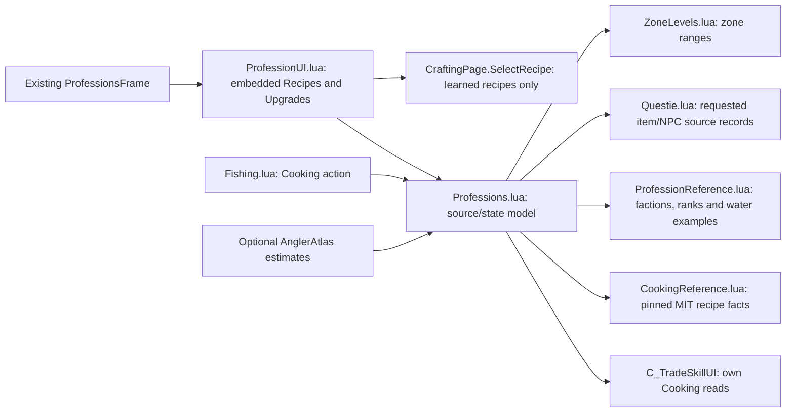
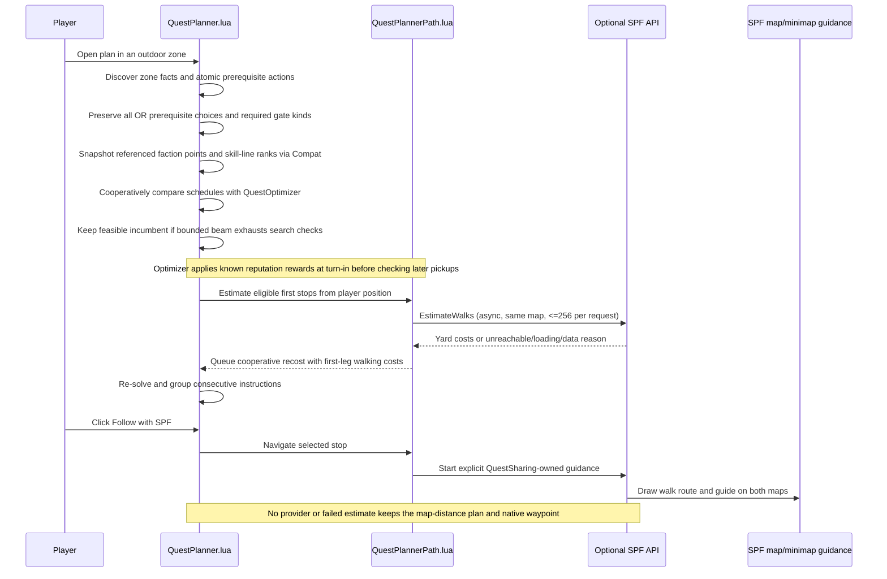
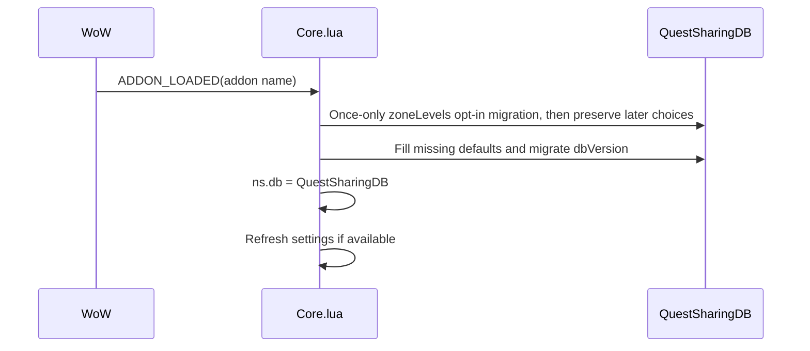
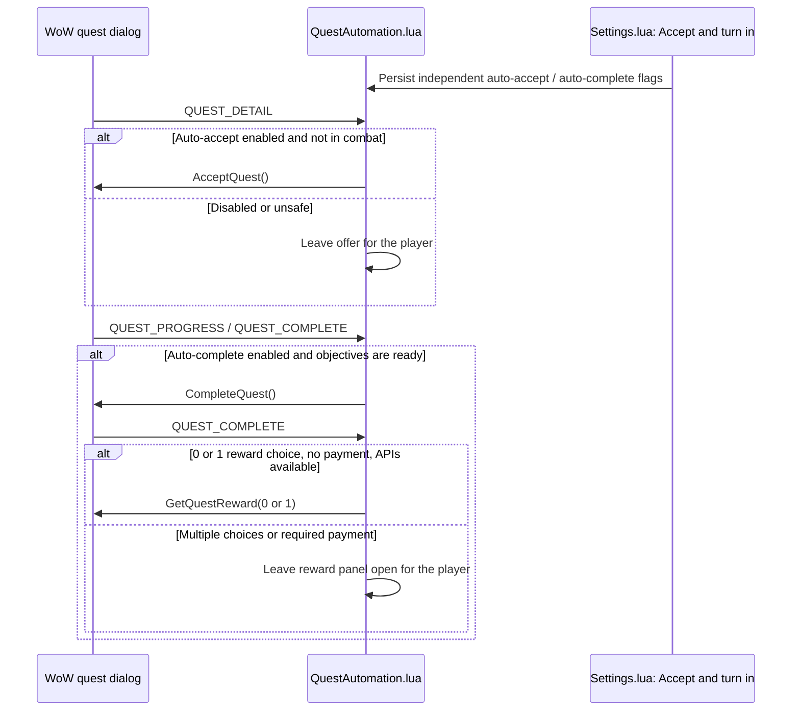
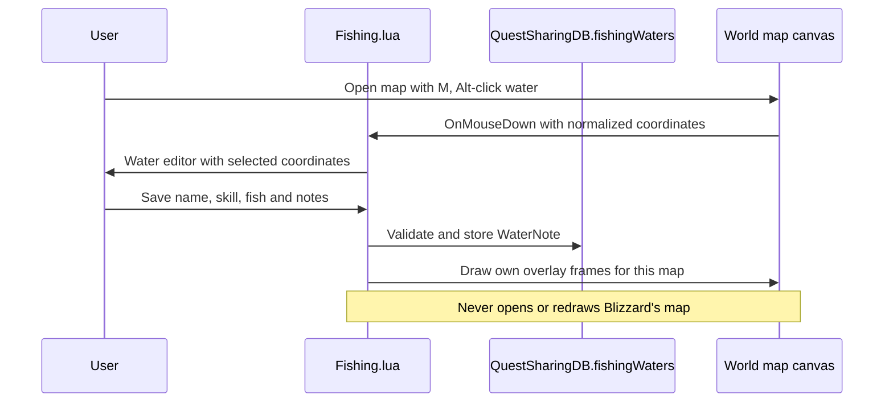
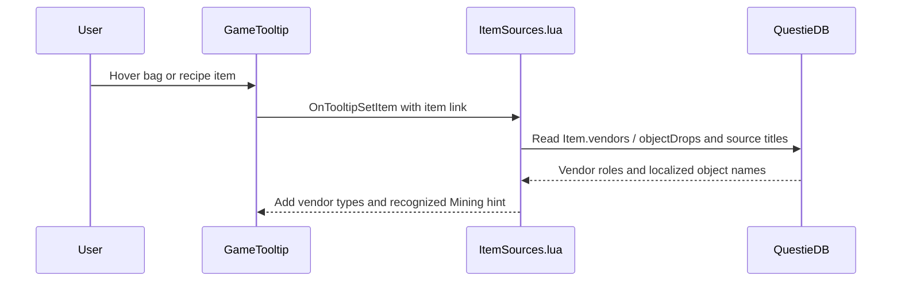

# Architecture
Last updated: 2026-11-17

## File tree
```text
QuestSharing/  # Repository root
├── .gitignore  # Exclude caches and release output
├── CHANGELOG.md  # Release history
├── QuestSharing/  # WoW addon runtime
│   ├── Adventure.lua  # Direct quest-group question in current chat and optional role-play invitation editor
│   ├── Bags.lua  # quest items marked in your bags, so you only carry what this zone needs
│   ├── Bindings.xml  # Game key bindings
│   ├── Compat.lua  # one place that knows the differences between the classic and the modern quest APIs
│   ├── Core.lua  # settings, timers, events, chat helpers, master-tool lifecycle and /qs commands
│   ├── CookingReference.lua  # Pinned MIT Forever Cooking facts: spells, ingredients and acquisition hints
│   ├── DataWork.lua  # Shared cooperative database queue, 2ms slices, pause/resume and combat suspension
│   ├── Diagnostics.lua  # Readable issue overview and full snapshot; Copy all includes all retained technical records
│   ├── Friends.lua  # add the people you group with to your friends list
│   ├── DungeonQuests.lua  # Dungeon catalogue, separate chain/task labels, locations, hover XP/rewards and quest actions
│   ├── EquipmentUI.lua  # Three-tab WoW-style journal skin, native buttons/slots, parchment details and scoped filters
│   ├── Fishing.lua  # Optional world-map water notes, editor and AnglerAtlas zone summaries
│   ├── Highlight.lua  # make quest objectives easier to find
│   ├── ItemSources.lua  # optional Questie source hints on bag and recipe item tooltips
│   ├── Loot.lua  # Equipment-only instance browser with AtlasLoot tables and partial QuestieDB fallback
│   ├── Marker.lua  # showing each other where you are
│   ├── Menu.lua  # Shared quest menu; optional catalogue pickup actions and absent-log guards
│   ├── MinimapButton.lua  # a small button on the minimap
│   ├── OptionalUI.lua  # Shared frames, edit boxes, scrolling, tooltips and read-only map directions
│   ├── Panel.lua  # shows which party members share your quests
│   ├── Ping.lua  # one key (or a click on the ring) pings the nearest creature one of your quests needs with the game's
│   ├── Progress.lua  # notices when the objectives of one of your quests are all done, tells the party
│   ├── ProfessionReference.lua  # Static rank requirements, faction trainers/books/quests and example fish waters
│   ├── Professions.lua  # Recipe/farming model, own-Cooking learned-state reads and native-window lifecycle
│   ├── ProfessionUI.lua  # Embedded scrolling recipe list, native known-recipe crafting and in-place source/Upgrades panes
│   ├── QuestAutomation.lua  # opt-in quest offer acceptance and safe turn-ins
│   ├── QuestCleanup.lua  # On-demand carried-bag leftovers review and freshly validated per-stack deletion
│   ├── QuestItems.lua  # quest items you can USE (a torch to light, a flare to throw...)
│   ├── QuestSharing.toc  # Addon metadata and module load order
│   ├── Questie.lua  # if the Questie addon is installed, its quest database tells us where a quest starts and which quests
│   ├── QuestGuidance.lua  # Selected-step direction/distance HUD and own numbered map-route overlay
│   ├── QuestOptimizer.lua  # Seeded and bounded-beam schedule search, compatible kill/drop expectation and four goals
│   ├── QuestPlanner.lua  # Zone facts/actions, plan controls/report, stable replanning, guide, waypoint and SPF actions
│   ├── QuestPlannerPath.lua  # optional SPF API detection, walk-cost requests, cancellation and outing promotion
│   ├── Quick.lua  # a quick-chat wheel
│   ├── Rewards.lua  # On-demand QuestieDB reward catalogue, eligibility filters and item comparisons
│   ├── Settings.lua  # Sidebar settings; Extra tools / Browser DB cards, separate switches/actions, scrolling and key capture
│   ├── Share.lua  # notice a new party, push the quests of the area one by one, read the game's replies
│   ├── SpellRanks.lua  # Opt-in learned spell-rank upgrades across player action-bar pages
│   ├── Status.lua  # what to say about a quest you click in the tracker, and the hooks that notice the click
│   ├── Style.lua  # one look for every window of the addon (settings, Party quests, reports)
│   ├── Sync.lua  # party members who also run Quest Sharing tell each other exactly which quests they have
│   ├── Team.lua  # "Picked up [Wolves Among Us] - Anna has it too. Want to do it together?"
│   ├── Track.lua  # keeps the quest tracker (the list on the right) filled with the quests closest to you
│   ├── VendorMap.lua  # optional item/vendor map search, database availability feedback, autocomplete and own pins
│   └── ZoneLevels.lua  # Read-only map questing ranges, outdoor zone badges and hover panel
├── README.md  # User documentation
├── build_release.py  # Build install ZIP and release notes
├── tools/  # Local UI emulation utilities, never shipped in the addon
│   ├── build_cooking_reference.py  # Rebuild pinned factual Cooking subset with upstream MIT attribution
│   ├── preview_professions.py  # Export actual profession model into an illustrative native-window layout preview
│   ├── profession-preview.html  # Embedded recipe-list/source/Upgrades visual template with sample learned states
│   ├── preview_search_journal.py  # Export real Lua search rows/details to a local journal layout emulation
│   ├── search-journal-preview.html  # Interactive three-tab journal layout emulation; native textures approximated
│   ├── preview_quest_planner.py  # Run actual Lua planner and embed its rows in the Westfall emulation
│   └── quest-guide-preview.html  # Interactive compact-guide fragment template with navigation, mini mode and lock
├── context/  # Session continuity and live architecture
│   ├── BUGS/  # Verified bug methodology and regressions
│   │   ├── 2026-11-17-planner-multiple-drop-confidence.md  # Label unverified overlap between separate loot streams
│   │   ├── 2026-11-17-planner-or-parent-selection.md  # Preserve OR gate choices through routing and selected completion
│   │   ├── 2026-11-17-profession-window-layout.md  # Standalone companion mismatch; embedded native list/detail and readable hierarchy
│   │   ├── 2026-11-17-map-search-missing-database.md  # Missing-data feedback, standalone QuestieDB and late-provider retry
│   │   ├── 2026-11-17-guidance-submap-rectangle.md  # Preserve four native bounds across submap projection
│   │   ├── 2026-11-17-guidance-late-map-metrics.md  # Throttled recovery from absent initial measurements
│   │   ├── 2026-11-17-guidance-selected-cluster-marker.md  # Keep selected number/position in grouped map markers
│   │   ├── 2026-11-17-guidance-map-click-event-argument.md  # Core event-prefix contract for guidance map selection
│   │   ├── 2026-11-17-optional-database-eager-loading.md  # Lazy catalogue lifecycle, shared budget and cache reuse
│   │   ├── 2026-11-17-map-suggestions-readable-background.md  # Opaque autocomplete and explicit layering above the map
│   │   ├── 2026-11-16-vendor-map-scope-and-missing-roles.md  # Incomplete role indexing, suggestion scope and explicit fallback
│   │   ├── 2026-11-16-quest-recruitment-extra-editor.md  # Direct chat recruitment instead of mandatory composer
│   │   ├── 2026-11-16-quest-planner-distant-spawns-and-next-command.md  # Distant objective camps and safe next-stop selection
│   │   ├── 2026-11-16-quest-planner-empty-level-and-candidate-shape.md  # Missing Questie levels and direct candidate fields
│   │   ├── 2026-11-16-quest-planner-final-batch-and-zone-scope.md  # Final scan render binding and outdoor-zone guard
│   │   ├── 2026-11-16-quest-planner-movable-panel.md  # Session drag positioning and native frame movement
│   │   ├── 2026-11-16-quest-planner-missing-local-pickups.md  # Local starter discovery with an empty quest log
│   │   ├── 2026-11-16-quest-planner-scroll-row-overlap.md  # Variable-height scrolling rows and readable layout
│   │   ├── 2026-11-15-settings-extra-tools-overflow.md  # Fixed-height settings overflow diagnosis
│   │   ├── 2026-11-13-zone-levels-empty-native-data.md  # Standalone guide fallbacks when native ranges are empty
│   │   ├── 2026-11-13-equipment-duplicate-rows.md  # Filtered name grouping with complete source retention
│   │   ├── 2026-11-13-zone-levels-opt-in.md  # Once-only migration from auto-enabled map ranges
│   │   ├── 2026-11-13-spell-rank-zero-spec.md  # Numeric-zero active specialization in Lua
│   │   ├── 2026-11-13-spell-rank-cursor-read.md  # Preserve readability separately from an empty cursor
│   │   ├── 2026-11-13-spell-rank-hidden-pages.md  # Native slot range differs from visible pages
│   │   ├── 2026-11-13-dropdown-offscreen-selection.md  # Mixed wheel/keyboard dropdown navigation
│   │   ├── 2026-11-13-debounced-filter-reapply.md  # Range commit debounce cancellation playbook
│   │   └── 2026-11-13-instance-loot-non-equipment.md  # Equipment filtering reproduction and fix
│   ├── architecture.md  # Live source map and runtime diagrams
│   ├── decisions.md  # Choices and rationale
│   ├── insights.md  # Timestamped findings
│   ├── profession-reference-research.md  # Forever guide sources, pinned recipe-data provenance and live API boundaries
│   ├── quest-narration-research.md  # Separate local voice-acting addon proposals and verified source limits
│   ├── quest-optimization-research.md  # Prior art and proposed quest graph/route optimizer design
│   ├── predictive-quest-optimizer.md  # Implemented algorithm, executed simulation and evidence limits
│   ├── quest-planner-routing-and-validation-plan.md  # SPF integration behavior, automated coverage and pending in-game checks
│   ├── schema.md  # Data structures and formats
│   ├── shortest-path-source-study.md  # External router implementation trace; no runtime dependency
│   ├── state.md  # Current task and handoff
│   └── walkable-routing-research.md  # Terrain-routing feasibility, provider sources and proposed integration (not implemented)
└── tests/  # Python tests and Lua API harness
    ├── harness.py  # Mock WoW APIs and load Lua addon
    ├── test_data_budget.py  # No catalogue preload, hidden-tool idle behavior, zone-cache reuse and shared work budget
    ├── test_adventure.py  # Direct quest questions, invitation generation, chat routes, preview and draft preservation
    ├── test_bags.py  # Tests for bags
    ├── test_quest_cleanup.py  # Cleanup eligibility, protected quest items, confirmation, stale state and cursor/client refusal
    ├── test_box.py  # Tests for box
    ├── test_done.py  # Tests for done
    ├── test_dungeon_quests.py  # Inside/outside dungeon chains, filters, pickup menus, cancellation and common-material exclusion
    ├── test_equipment.py  # Shared window, type/level filters, dungeon identity and cancellation
    ├── test_equipment_grouping.py  # Unique names, combined suppliers/routes, versions and filter boundaries
    ├── test_emotes.py  # Tests for emotes
    ├── test_extras.py  # Tests for extras
    ├── test_features.py  # Tests for features
    ├── test_friends.py  # Tests for friends
    ├── test_highlight.py  # Tests for highlight
    ├── test_items.py  # Tests for items
    ├── test_instance_focus.py  # Current dungeon opening, delayed catalogue focus, manual navigation and Extra tools label
    ├── test_log.py  # Tests for log
    ├── test_loot.py  # Instance loot parsing, search, provider fallback and asynchronous item names
    ├── test_look.py  # Settings viewport/layout, key capture, sounds and ring appearance
    ├── test_menu.py  # Tests for menu
    ├── test_optional.py  # Optional tool integration, water persistence, reward eligibility and comparisons
    ├── test_professions.py  # Cooking reference, live learned-state guards, recipe/farming sources, rank/faction UI and cancellation
    ├── test_ping.py  # Tests for ping
    ├── test_questmap.py  # How-to quest text and retired map-overlay guards
    ├── test_planner_facts.py  # Provider units/counts, character restrictions and deep zone chains
    ├── test_quest_optimizer.py  # Predictive simulation, four goals, constraints and public guide integration
    ├── test_quest_planner_path.py  # Optional SPF API, walk-cost ordering, cancellation and fallback
    ├── test_quest_guidance.py  # Arrow/world-size math, grouped route selection, own map lines, lifecycle, fallbacks and idle reads
    ├── test_quest_planner_guide.py  # Current/upcoming styling, previous/next, mini mode and session lock
    ├── test_quest_planner_zone_steps.py  # Westfall scope, foreign projections, grouped instructions and completion dependencies
    ├── test_quest_planner_ui.py  # Planner movement, wrapped layout, level bands, pickups and map clicks
    ├── test_questsharing.py  # Tests for questsharing
    ├── test_quick.py  # Tests for quick
    ├── test_ringtest.py  # Tests for ringtest
    ├── test_settings.py  # Settings persistence, direct controls, wrapped rows, scroll reachability and enemy markers
    ├── test_stats.py  # Shared stat minimums, native API compatibility, live controls and cache invalidation
    ├── test_spell_ranks.py  # Learned ranks, guarded action-slot swaps, combat/cursor deferral and API compatibility
    ├── test_team.py  # Tests for team
    ├── test_together.py  # Tests for together
    ├── test_tracker.py  # Tests for tracker
    ├── test_triggers.py  # Tests for triggers
    ├── test_usability.py  # Direct choices, live searches, sorting, selection and navigation workflows
    ├── test_vendor_map.py  # Local sellers/class trainers, role/item discovery, suggestions, counts and explicit remote fallback
    ├── test_where.py  # Tests for where
    ├── test_zone.py  # Tests for zone
    └── test_zone_levels.py  # Native map ranges, geometry, hover, lifecycle, settings and safe read-only behavior
```

## Flowchart

```mermaid
flowchart TD
    TOC[QuestSharing.toc] --> Compat[Compat.lua: ns.compat]
    TOC --> Core[Core.lua: events, settings, timers]
    Core --> Diagnostics[Diagnostics.lua: log / errors / doctor combined snapshot]
    Settings --> Diagnostics
    Diagnostics --> DiagnosticStore[QuestSharingLog and QuestSharingDB.errors: bounded saved records]
    Diagnostics --> Report[QuestSharingReport: issue overview, full details, Copy all, Refresh and Clear records]
    Core --> Share[Share.lua: quest offers]
    Core --> DataWork[DataWork.lua: shared optional database work budget]
    Core --> Sync[Sync.lua: party addon messages]
    DB[Optional QuestieDB] --> Q[Questie.lua: ns.questie]
    Settings --> Planner[QuestPlanner.lua: optional local quest plan]
    Core --> Planner
    Planner --> Guidance[QuestGuidance.lua: arrow, distance, numbered stops and straight connections]
    Guidance --> MapAPI
    Planner --> DataWork
    Planner --> Q
    Planner --> Compat
    Compat --> Inventory[Carried bags and live level/XP snapshot]
    Compat --> CharacterAPI[C_Reputation / GetFactionInfoByID / C_SkillInfo: referenced factions and skills]
    Planner --> Levels[GetQuestDifficultyColor: optional explicit green-yellow filter]
    Planner --> Optimizer[QuestOptimizer.lua: seeded route plus bounded beam over legal action orders]
    Optimizer --> DataWork
    Planner --> MapAPI[C_Map ancestry-validated zone projection, known place names and user waypoint]
    Planner --> Style[Style.lua: opaque compact guide, current/upcoming rows, navigation and mini mode]
    Planner --> Preview[tools/preview_quest_planner.py: real Lua rows to browser emulation]
    Preview --> PreviewTemplate[tools/quest-guide-preview.html: interactive reference-led guide]
    Planner --> Path[QuestPlannerPath.lua: optional SPF adapter]
    Path --> SPF[Optional ShortestPathForever.API: EstimateWalks and Navigate]
    Path -. unsupported or missing .-> Planner
    Share --> API[WoW APIs via Compat.lua]
    Sync --> API
    Settings[Settings.lua: sidebar categories] --> Tools[Extra tools: utility cards]
    Settings --> Browser[Browser DB: lookup cards]
    Tools --> Fishing[Fishing.lua: water notes]
    Tools --> Cleanup[QuestCleanup.lua: review leftovers on demand]
    Core --> Cleanup
    Cleanup --> Q
    Cleanup --> Compat
    Cleanup --> BagAPI[Carried bags and explicit cursor item deletion]
    Browser --> ItemSources[ItemSources.lua: item tooltip source hints]
    Browser --> VendorMap[VendorMap.lua: item/vendor search and map pins]
    Browser --> Rewards[Rewards.lua: reward browser]
    OptionalUI[OptionalUI.lua] --> Equipment[EquipmentUI.lua: shared WoW-style journal; equipment tabs Rare+ only]
    Equipment --> NativeJournalArt[Built-in dialog, QuestBG, Quickslot2 and red button textures]
    Equipment --> Parchment[Scoped dark-ink scrollable detail pages]
    Equipment --> Rewards
    Equipment --> Loot
    Rewards --> Group[EquipmentUI.groupItems: filter first, one row per name]
    Loot --> Group
    Group --> Inline[Single inline detail pane: every matching source and version]
    Equipment --> StatAPI[WoW GetItemStats: lazy link cache, invalidated on item events]
    Tools --> Ranks[SpellRanks.lua: opt-in action-bar rank updates]
    Core --> Ranks
    Ranks --> SpellBook[WoW learned player spell book]
    Ranks --> ActionSlots[WoW normal action slots, out of combat and cursor clear]
    Settings --> ZoneLevels[ZoneLevels.lua: zone questing ranges]
    Core --> ZoneLevels
    Settings --> QuestAutomation[QuestAutomation.lua: optional event-driven quest actions]
    Core --> QuestAutomation
    QuestAutomation --> QuestAPI[WoW QUEST_DETAIL / QUEST_PROGRESS / QUEST_COMPLETE and quest action APIs]
    ZoneLevels --> NativeMap[C_Map level ranges, zone bounds and hover info]
    ZoneLevels --> ZoneGuides[Local UI-map guides and labelled known-quest spans; fallback only]
    ZoneLevels --> MapLabels[Own click-through map labels and panel]
    OptionalUI --> Fishing
    OptionalUI --> Rewards
    Fishing --> Waters[(QuestSharingDB.fishingWaters)]
    Atlas[Optional AnglerAtlas] --> Fishing
    Rewards --> Q
    ItemSources --> Q
    VendorMap --> DataWork
    VendorMap --> Q
    VendorMap --> ExistingMap[WorldMapFrame and C_Map]
    VendorMap --> Waypoint[Compat.lua: user waypoint]
    Rewards --> Items[WoW item info and comparison tooltips]
    Browser --> Loot[Loot.lua: instance drop search]
    Browser --> DungeonQuests[DungeonQuests.lua: dungeon quest catalogue]
    DungeonQuests --> Equipment
    DungeonQuests --> Q
    DungeonQuests --> Loot
    DungeonQuests --> QuestXP[QuestieDB QuestXP support: base experience]
    DungeonQuests --> RewardLinks[QuestieDB Item.questRewards: first-hover reward index]
    DungeonQuests --> DataWork
    DungeonQuests --> Menu[Menu.lua: quest and pickup actions]
    Loot --> AtlasLoot[Optional AtlasLoot encounter tables]
    Loot --> Q
    Loot --> Items
    Loot --> Location[WoW GetInstanceInfo and localized subzone names]
    Loot --> Rewards
    QuestMenu[Menu.lua: Ask in chat to do this quest] --> Adventure[Adventure.lua: question and prepare]
    Adventure --> Composer[Optional editor: Extra tools or qs adventure]
    Core --> Adventure
    Settings --> Adventure
    Adventure --> Compat[Compat.lua: quest log and links]
    Adventure --> Chat[Existing chat draft or ChatFrame_OpenChat]
```




## Sequence diagrams
```mermaid
sequenceDiagram
    participant Player
    participant Settings as Settings.lua: Extra tools / Browser DB
    participant Feature as Selected tool module
    participant Core as Core.lua: ns.db
    Player->>Settings: Choose a category
    Settings-->>Player: Cards with purpose, requirements and controls
    Player->>Settings: Click primary action
    Settings->>Feature: settingsAction -> row.action (explicit open)
    Player->>Settings: Click persistent checkbox
    Settings->>Core: settingsClick -> setSetting(key, value)
    Settings-->>Player: Refresh card state; preserve reading position
```


```mermaid
sequenceDiagram
    participant Core as Core.lua
    participant Saved as QuestSharingDB / QuestSharingLog
    participant Report as Diagnostics.lua
    participant Player
    Core->>Saved: Enable debug once via diagnosticsDefaultMigrated; preserve later off
    Core->>Saved: Record bounded actions and errors
    Player->>Report: /qs log, /qs errors, /qs doctor or settings
    Report->>Saved: Read all retained logs and full errors
    Report->>Report: Build diagnosticOverview and diagnosticLines from same checks
    Report-->>Player: Readable overview, no selection or chat dump
    Player->>Report: Show full report / Show overview
    Report-->>Player: Switch stored views without refreshing
    Player->>Report: Copy all
    Report-->>Player: Select full snapshot including hidden technical details
    Player->>Player: Ctrl+C / Cmd+C copies everything
    Player->>Report: Refresh (explicit only)
    Report->>Saved: Read fresh snapshot and preserve current view
```


```mermaid
sequenceDiagram
    participant User
    participant Native as ProfessionsFrame.CraftingPage
    participant UI as ProfessionUI.lua
    participant Model as Professions.lua
    participant API as C_TradeSkillUI
    User->>Native: Open Cooking
    Native->>Model: TRADE_SKILL_SHOW / DATA_SOURCE_CHANGED
    Model->>API: Verify own Cooking; read 12 spell states per timer slice
    Model->>UI: Refresh embedded scrolling list
    UI-->>User: Recipe, skill, short source; grey unlearned rows
    User->>UI: Select learned recipe
    UI->>Native: SelectRecipe(actualInfo,true)
    Native-->>User: Existing schematic and Create controls
    User->>UI: Select unlearned recipe
    UI->>Native: Clear transaction; Init(nil); ValidateControls
    UI->>Model: Acquisition/ingredient sources for selected record
    UI-->>User: In-place requirements, source and ingredient pane
    User->>UI: Upgrades tab; profession/faction buttons
    UI-->>User: Static ranks inside the same native window
    Note over UI,API: No standalone window, filter toggles or automatic crafting
```
```mermaid
sequenceDiagram
    participant User
    participant D as DungeonQuests.lua
    participant Work as DataWork.lua
    participant Q as Questie.lua / QuestieDB
    participant Menu as Menu.lua
    participant Game as Compat.lua waypoint
    User->>D: Open Dungeon quests / qs dungeons
    D->>Work: Start visible-only cooperative scan
    Work->>Q: Quest categories, restrictions and source locations
    Q-->>Work: Records, prerequisites and explicit follow-ups
    Work->>D: Associate dungeons, outdoor chains and bidirectional chain links; ready catalogue
    User->>D: Select dungeon, faction, class and level
    D->>D: Show independent chain status, task type and pickup/turn-in lines
    User->>D: Hover quest
    D->>Q: Read QuestXP base row; cached pickup and turn-in sources
    D->>Work: First hover only: enumerate item reward links in small slices
    Work-->>D: Per-quest reward item IDs
    D-->>User: Refresh active tooltip with XP and all known item rewards
    User->>D: Right-click quest
    D->>Menu: Usual actions plus two pickup actions
    User->>Menu: Show pickup on map
    Menu->>D: Resolve mapped pickup source
    D->>Game: Native waypoint when coordinates supported
    D-->>User: Pickup coordinates; open map manually with M
    Note over Work: Combat pauses; close/tab/master disable cancels unfinished work
```

```mermaid
sequenceDiagram
    participant Player
    participant Tool as QuestCleanup.lua
    participant Quest as Compat.lua + Questie.lua
    participant Bags as WoW bag/cursor APIs
    Player->>Tool: Extra tools Review items or /qs cleanup
    Tool->>Quest: Snapshot all current quests and required/source/special items
    Tool->>Bags: Read carried bag stacks and native quest flags
    Tool->>Quest: Check item class, startQuest, relatedQuests
    Tool-->>Player: Possible leftovers, count and bag slot
    Player->>Tool: Review stack, then Delete stack
    Tool->>Quest: Recheck current quest requirements
    Tool->>Bags: Recheck same slot, item, link, count and empty readable cursor
    Tool->>Bags: Pick up reviewed stack; verify cursor identity
    Tool->>Quest: Recheck after synchronous pickup callbacks
    Tool->>Bags: Verify cursor again; DeleteCursorItem
    Tool-->>Player: Rescan or explain client refusal
    Note over Tool: Bag/quest/combat events invalidate review; no background scans
```

```mermaid
sequenceDiagram
    participant Player
    participant UI as Settings.lua
    participant Saved as Core.lua: ns.setSetting
    participant Feature as Existing feature modules
    Player->>UI: Choose a sidebar category
    UI->>UI: Lay out wrapped explanations and controls in scroll body
    Player->>UI: Toggle checkbox, choose named option or press +/-
    UI->>Saved: Persist existing setting key and value
    Saved->>Feature: Apply existing setting side effects
    UI->>UI: Refresh labels and selected explanation; preserve/clamp scroll
    Note over UI: Quick chat editor shares the scroll body; category changes reset scroll
```

```mermaid
sequenceDiagram
    participant User
    participant Map as Existing world map
    participant Levels as ZoneLevels.lua
    participant Data as C_Map
    User->>Map: Open or navigate map normally
    Levels->>Map: Read shown map, canvas and normalized cursor
    Levels->>Data: Read outdoor zone levels and child-zone rectangles
    alt Native range missing, zero or invalid
        Levels->>Levels: Use verified UI-map guide or labelled known-quest span; cities/sanctuary have role labels
        Note over Levels: Do not cache fallback; unknown future areas remain unknown
    else Valid native range
        Levels->>Levels: Cache native range; prefer over guide
    end
    Levels->>Map: Draw own click-through range badges and information panel
    Note over Levels,Map: Never opens, navigates or refreshes Blizzard map/pins
    User->>Map: Hover or view another zone
    Levels->>Data: Read hovered zone and its range
    Levels->>Map: Update own text only
```



```mermaid
sequenceDiagram
    participant User
    participant Settings as Settings.lua / Core.lua
    participant Ranks as SpellRanks.lua
    participant Game as WoW spell book and action bars
    User->>Settings: Enable highest learned ranks in Extra tools
    Settings->>Ranks: Debounce update; also login / learned spells / placed actions
    Ranks->>Game: Read learned player spells and existing normal bar slots
    alt Combat, temporary bar or cursor occupied
        Ranks->>Ranks: Wait for combat/cursor/bar event
    else Ready
        Ranks->>Game: Pick up higher learned rank; verify cursor; place in same spell slot
        Game-->>Ranks: Revalidate target after pickup; read back replacement and release swapped old rank
        Ranks->>User: Updated count or client limitation
    end
```








```mermaid
sequenceDiagram
    participant User
    participant Rewards as Rewards.lua
    participant Items as QuestieDB ItemDB
    participant Q as Questie.lua
    participant Game as WoW item APIs
    User->>Rewards: Open shared EquipmentUI quest tab
    Rewards->>Items: GetAllIds; read 100 items per timer batch
    Items-->>Rewards: Equipment and questRewards links
    Rewards->>Q: Read quest level, class/race masks and starter
    Rewards->>Game: Get item details for eligible rewards
    Rewards->>Rewards: Group filtered equipment by name; collect every eligible quest route
    Rewards->>User: Paginated unique equipment names
    Game-->>Rewards: GET_ITEM_INFO_RECEIVED
    Rewards->>User: Debounced refresh of cached item details
    User->>Rewards: Hover item / click quest
    Rewards->>Game: Item and equipped comparison tooltip
    Rewards->>User: All matching quest starters/prerequisites inline; map directions use first route
```

```mermaid
sequenceDiagram
    participant User
    participant Menu as Menu.lua / Core.lua / Settings.lua
    participant Adventure as Adventure.lua
    participant Compat as Compat.lua
    participant Chat as WoW chat edit box
    alt Quest right-click menu
        User->>Menu: Ask in chat to do this quest (row 2)
        Menu->>Adventure: ask(clicked quest)
        Adventure->>Compat: Revalidate unfinished quest and read its link
        Adventure->>Chat: Anyone need [quest]? Wanna group up? (current channel)
    else Extra tools or qs adventure
        User->>Adventure: Open optional invitation editor
        Adventure->>User: Editable role-play invitation, wording and channel
        User->>Adventure: Prepare chat
        Adventure->>Compat: Revalidate unfinished quest
        Adventure->>Chat: Prepare in chosen channel
    end
    Note over Adventure,Chat: Reuse prepare; retain drafts and channel attributes; reject duplicates and oversize text
    User->>Chat: Press Enter to send
```

```mermaid
sequenceDiagram
    participant User
    participant Loot as Loot.lua
    participant Atlas as AtlasLoot ItemDB
    participant Questie as Questie.lua
    participant Game as WoW item APIs
    User->>Loot: Open instance drops
    Loot->>Game: Read current party-instance ID, name and subzone
    Loot->>Atlas: Read installed Classic/Forever dungeon tables; reject raids/world bosses
    alt Compatible AtlasLoot data available
        Atlas-->>Loot: Instances, encounters, difficulties and item IDs
    else No compatible encounter catalogue
        Loot->>Questie: Enumerate item drops from instance NPC/object spawns
        Note over Loot,Questie: Label coverage as partial
    end
    Loot->>Loot: Index up to 100 rows per timer batch
    Loot->>Loot: After indexing, select recognized current dungeon and reveal its navigation page
    Note over User,Loot: Manual location/search changes cancel pending focus; later refreshes preserve browsing
    Loot->>Game: Load up to 10 item details per timer batch (Rewards.itemInfo)
    User->>Loot: Filter dungeon, encounter or item/boss text; shared type/slot/level filters
    Loot->>Loot: Require recognized equipment slot and native quality 3+; hide unknown items
    Loot->>Loot: Group filtered names; combine each supplier's difficulty labels
    Loot->>User: One equipment row per name; all suppliers and versions inline
    Game-->>Loot: GET_ITEM_INFO_RECEIVED
    Loot->>User: Debounced equipment classification and name refresh
```

```mermaid
sequenceDiagram
    participant User
    participant E as EquipmentUI.lua
    participant Page as Rewards.lua / Loot.lua
    User->>E: Open quest or dungeon tab
    E->>Page: Hide old page and suspend pending work
    E->>Page: Show selected child in same host
    User->>E: Apply type, slot, inclusive level range or up to three stat minimums
    User->>E: Search dropdown choices / type live query / scroll results
    E->>Page: Debounced search or direct filter selection; keep quality 3+
    Page->>E: matches native item metadata
    E->>E: Read cached native stat table only for active conditions; require all minimums
    Page->>E: groupItems(filtered sources) by normalized name
    E->>Page: Sort unique equipment; preserve selected name if visible
    User->>Page: Select item card
    Page->>E: Update inline route/source pane
    User->>E: Close explorer
    E->>Page: Cancel unfinished timers and hide child
```



```mermaid
sequenceDiagram
    participant User
    participant Map as Existing world map
    participant Search as VendorMap.lua
    participant Adapter as Questie.lua
    participant DB as QuestieDB
    participant Work as DataWork.lua
    Note over Search,DB: No catalogue reads on login or blank map
    Search->>Adapter: canEnumerate(npc/item): inspect methods only
    alt Missing or non-enumerable database
        Search->>Search: Cancel/reset stale index, suggestions and pins
        Search-->>User: Install/update QuestieDB, /reload, /qs questie
        Note over Search,Adapter: Preserve query; retry when provider becomes available
    else Enumerable NPC or item database
        Search-->>User: Blank-map help names QuestieDB and search scope
    end
    User->>Search: Type a query or select a result
    Search->>Work: Debounce then start/resume vendor-search
    Work->>DB: Index NPC titles/flags once; item links only when needed
    Work->>DB: Decode locations only for current matching candidates
    Note over Work,DB: Shared soft 2ms slices; combat/hidden pauses; query change cancels
    Search-->>User: Show suggestions with usable locations on the displayed map
    User->>Search: Choose suggestion, press Enter, or click search icon
    Search->>Search: Interpret vendor as all sellers; general vendor as matching seller roles
    Search->>Search: roleWords normalizes aliases/plurals/punctuation; roleMatch prefers literal matches
    Search->>Search: oneTypo fallback only when no literal/alias item or role pin is local
    Search->>Map: Draw every matching pin; retain selected role/item kind
    Search-->>User: Show displayed map, query and location count
    alt Query is empty or Clear is clicked
        Search->>Map: Hide all pins immediately
    else No matching pin on shown map but known matches exist
        Search->>User: Show zero locations and Elsewhere button
        User->>Search: Click Elsewhere explicitly
        Search-->>User: Offer nearest same-continent waypoint or explain missing coordinates
    else No known seller link or matching title
        Search->>User: Explain database coverage and vendor-only search
    end
    User->>Map: Click map pin or Waypoint button
    Map->>DB: Use vendor map coordinates with Compat.setWaypoint
```

```mermaid
sequenceDiagram
    participant Player
    participant Entry as Settings.lua / Core.lua
    participant Planner as QuestPlanner.lua
    participant Questie as Questie.lua / QuestieDB
    participant Log as Compat.lua quest log
    participant Map as C_Map / user waypoint
    participant Style as Style.lua window
    Player->>Entry: Enable planner or open /qs plan
    Entry->>Planner: Open panel and scan
    participant Work as DataWork.lua
    Note over Entry,Questie: Saved enabled setting does not scan on login
    Player->>Planner: Change zone while guide is visible
    Planner->>Planner: Debounce event; clear old steps if map changed
    Planner->>Map: Check outdoor Zone map and city status
    alt Town, city, dungeon, continent or missing map
        Planner-->>Player: Clear plan and explain outdoor-zone requirement
    else Outdoor zone
        Planner->>Work: Start quest-plan; cancel prior generation
        alt Cached zone IDs available
            Work->>Planner: Reuse local starter IDs plus active log IDs
        else First open in zone or explicit Refresh
            Work->>Questie: Enumerate quest IDs; cache local starters for last two zones
        end
        Note over Work,Questie: Shared soft 2ms slices; cache up to 256 repeated sources per scan
        loop During scan
            Planner->>Map: Recheck player map
            alt Entered town or non-zone map
                Planner-->>Player: Stop scan and clear plan
            else Changed outdoor zone
                Planner->>Planner: Cancel old scan and restart for new zone
            else Same outdoor zone
                Planner->>Questie: Keep locally completable pickups and local active work/hand-ins
            end
        end
        Planner->>Log: Read active quests and objective progress
        Planner->>Questie: Read readiness, prerequisites, starters, targets and turn-ins
        Planner->>Planner: Use all acceptance levels by default; optional green/yellow filter
        Planner->>Planner: Validate source-map ancestry and coordinates before planning any action
        Planner->>Planner: Keep AND/OR gates and atomic giver/work/turn-in actions
        Planner->>Planner: Keep different prerequisite depths in separate stops at the same giver/camp
        Planner->>Planner: Compare feasible schedules and shared kill/drop work
        Planner->>Map: Look up known place name at each local stop, otherwise use giver/objective name
        Planner->>Player: Show numbered Go/Take/Complete/Hand-in steps with stable quest numbers and every task
        Planner->>Player: Highlight current step and mute up to five upcoming steps
        Player->>Planner: Previous/next, mini/expanded or session lock control
        Planner->>Planner: Review step and set waypoint; never mark quest complete from navigation
        Player->>Planner: Left-click a stop
        Planner->>Map: Recheck plan map and set stop waypoint
        Player->>Planner: Right-click a stop
        Planner->>Map: Set native waypoint for the stop; player opens map normally
        Player->>Style: Drag the planner window
        Style-->>Planner: Keep the user-moved position for this session
        Planner->>Player: Size each row and scroll area for wrapped text
        alt No in-range quests; all are gray
            Planner-->>Player: Explain that this zone is too low level
        end
    end
    Player->>Planner: Accept/turn in quest or finish an objective
    Planner->>Log: Compare quest IDs and objective progress after debounce
    alt Quest list, completion flags or level changed
        Planner->>Work: Refresh eligibility from cached zone IDs plus active log IDs
    else Objective progress changed
        Planner->>Work: Rebuild stops cooperatively and preserve selected useful step
    end
    Player->>Planner: Close guide or disable master switch
    Planner->>Work: Cancel guide job; no background event scans
    Note over Planner,Map: Map distance only; terrain, caves, floors and walkable paths are not computed
```

```mermaid
sequenceDiagram
    participant Planner as QuestPlanner.showPlanRows
    participant Guide as QuestGuidance.lua
    participant Map as C_Map / GetPlayerFacing
    participant HUD as QuestSharingDirection
    participant Overlay as Own world-map overlay
    Planner->>Guide: set(route,selected,panel,selectCallback,actionCaption)
    Guide->>Map: Cache selected target world coordinates or native map dimensions
    Note over Guide,Map: Retry missing required measurements at most once per second while active
    Guide->>HUD: Show action/destination and direct distance; rotate facing-relative arrow
    loop Only while guide active, at most 10Hz
        Guide->>Map: Read player position/facing
        Guide->>HUD: Update bearing/distance; at destination keep same quest step
    end
    alt World map shown and not in combat
        Guide->>Overlay: Preserve four rectangle bounds; project verified ancestry and draw cached stop order
        Overlay->>Guide: Hover then matching global left-button down/up
        Guide->>Planner: Select step; cycle colocated numbers
        Guide->>Overlay: Keep selected number visible and use its exact projected position
        Planner->>Map: Set native user waypoint explicitly
    else Map hidden or combat
        Guide->>Overlay: Hide overlay; no map interactions
    end
    Planner->>Guide: clear on scan, close, zone invalidation or disable
    Guide->>HUD: Hide and remove OnUpdate
    Guide->>Overlay: Hide and drop route/hover references
```

## Class diagram

```mermaid
classDiagram
    class QuestOptimizer {
        optimize(catalog, atomicStops, options)
    }
    class AtomicQuestAction {
        id
        questID
        kind
        point
        dependencyIDs
        objectiveEvidence
    }
    class QuestCandidate {
        gates
        requiredMinRep
        requiredMaxRep
        reputationReward
        requiredSkill
        requiredRanks
    }
    class OptimizerState {
        claimed
        finishedQuests
        inventory
        reputation
        skillRanks
    }
    class OptimizerReport {
        mode
        expectedSeconds
        expectedKills
        completedIDs
        missingIDs
        reasons
        uncertainty
        searchChecks
        searchExhausted
        lootBounds
    }
    QuestOptimizer --> AtomicQuestAction
    QuestOptimizer --> QuestCandidate
    QuestOptimizer --> OptimizerState
    QuestOptimizer --> OptimizerReport
```


```mermaid
classDiagram
    class DiagnosticSnapshot {
        fullText
        overviewText
        showingDetails
        kind
    }
    class DiagnosticRecord {
        at
        source
        msg
        count
        detail_lines
    }
    DiagnosticSnapshot --> DiagnosticRecord : overview summaries and all full records share a fixed snapshot
```

```mermaid
classDiagram
    class CookingRecipeReference {
        id spellID
        name string
        skill number_or_nil
        ingredients itemID_count_pairs
        books recipeItemIDs
        sources strings
        uncertain boolean
    }
    class ProfessionRankReference {
        name string
        cap number
        skill number
        level number
        Alliance string
        Horde string
        method string
    }
    class ProfessionModel {
        learned spellID_to_boolean_or_nil
        materialCache itemID_to_lines
        scanToken cancellation_generation
        eventToken pending_native_event_generation
    }
    class EmbeddedProfessionView {
        host ProfessionsFrame
        native CraftingPage
        list RecipeList_child_overlay
        selected CookingRecipeReference
        rows pooled_44px_scroll_buttons
        missing in_place_source_pane
        upgrade ProfessionsFrame_child
    }
    ProfessionModel --> CookingRecipeReference : state and acquisition
    EmbeddedProfessionView --> ProfessionModel : query sources and learned state
    EmbeddedProfessionView --> ProfessionRankReference : selected profession and faction
```
```mermaid
classDiagram
    class DungeonQuestRecord {
        id
        name
        level
        required
        max
        classes
        races
        beforeAny
        beforeAll
        next
        dungeons
        dungeonText
        locations_pickups_and_turnIns
        chainBefore_ID_to_name
        chainAfter_ID_to_name
        taskLabel
        talkOnly
    }
    class DungeonQuestFilters {
        dungeon_areaID_or_zero
        faction
        class
        level
        allLevels
        completed
        text
    }
    class QuestCatalogueEntry {
        questID
        title
        level
        catalogue_true_if_absent_from_log
    }
    DungeonQuestFilters --> DungeonQuestRecord : selects unique IDs
    DungeonQuestRecord --> DungeonQuestRecord : prerequisites and explicit followups
    DungeonQuestRecord --> QuestCatalogueEntry : menu projection
```

The addon uses Lua tables and a shared namespace; these are data relationships, not declared classes.
```mermaid
classDiagram
    class Namespace {
        compat
        defaults
        db
        known
        offered
        questie
        itemSources
        vendorMap
        adventure
        fishing
        rewards
        loot
        equipmentUI
        spellRanks
        zoneLevels
        itemSources
        vendorSearch
        questPlanner
        questCleanup
    }
    class SettingRow {
        card_optional
        title_optional
        note_optional
        toggle_optional
        action_optional
        tab
        kind
        key_optional
        label
        desc
        values_optional
        names_optional
        help_by_selected_value_optional
    }
    Namespace --> SettingRow : settingRows drives Settings.lua
    class CleanupStack {
        bag
        slot
        id
        count
        link
        name
        quest
    }
    Namespace --> CleanupStack : questCleanup results and pending review, session only
    class Settings {
        debug_default_true
        diagnosticsDefaultMigrated
        dbVersion
        enabled
        bagMarks
        fishingMap
        rewardBrowser
        autoSpellRanks
        zoneLevels
        autoAcceptQuests
        autoCompleteQuests
        questPlanner
        zoneLevelsOptInMigrated
        fishingWaters
        hideTracker
    }
    class WaterNote {
        name
        map
        x_0_to_100
        y_0_to_100
        minSkill_optional
        safeSkill_optional
        fish
        notes
    }
    class VendorItemIndex {
        itemID
        localizedName
        vendorIDs
    }
    class VendorMapUI {
        bottomRightPanel
        opaqueSuggestionPopup_aboveMap
        displayedMapID
        query
        selectedKind_optional
        currentMapOnly
        searchEditBox
        searchIcon
        clearButton
        suggestions
        status
        waypoint_optional
    }
    class VendorPin {
        vendorID
        mapID
        x
        y
    }
    VendorMapUI --> VendorPin : one map view only
    class VendorLocation {
        vendorID
        categoryTitle
        spawns_area_map_x_y
    }
    VendorItemIndex --> VendorLocation : vendorIDs resolve only to known sellers
    class VendorRoleIndex {
        npcID
        localizedTitle
        isSeller
        roleWords
    }
    VendorRoleIndex --> VendorLocation : hydrate current query matches only
    class QuestGuidance {
        route_reference
        selectedIndex
        ownerPanel
        selectCallback
        targetWorld_north_west
        mapSize_fallback
        metricWait_oneSecond
        revision
        cachedViewGeometry
    }
    class DirectionHUD {
        actionCaption
        facingRelativeRotation
        directYardsOrUnavailable
        activeOnly_OnUpdate
    }
    class QuestRouteMarker {
        groupedStepIndices
        selectedStop_optional
        ownFrame_noClickScript
    }
    QuestGuidance --> DirectionHUD : selected step
    QuestGuidance --> QuestRouteMarker : grouped projected positions
    class DataWorkJob {
        owner
        thread
        valid
        paused
        finished
    }
    class ZoneQuestCache {
        mapID
        numericQuestIDs
        lastTwoZones
    }
    class PlannerSourceCache {
        kind_id_key
        name
        spawns
        max256_perScan
    }
    DataWorkJob --> ZoneQuestCache : guide discovery and reuse
    DataWorkJob --> PlannerSourceCache : bounded repeated-source reads
    DataWorkJob --> VendorRoleIndex : on demand
    class RewardOption {
        itemID
        info
        itemLevel
        slot
        questID
        questName
        requiredLevel
        zone
        cached
    }
    class InvitationDraft {
        questID
        wording_1_to_3
        previewText
        channelInput
    }
    class LootDrop {
        itemID
        item
        instanceKey
        instanceName
        who
        difficulty
        provider
        sourceID
        kind
    }
    class EquipmentGroup {
        key_normalized_name
        representative_source_fields
        sources
        itemIDs
        versions
        routes_or_suppliers
    }
    EquipmentGroup --> RewardOption : quest sources and routes
    EquipmentGroup --> LootDrop : dungeon sources and suppliers
    class DungeonRecord {
        key
        name
        count
        instanceID_optional
        subzones_localized_names
    }
    LootDrop --> DungeonRecord : instanceKey
    class NativeItemInfo {
        name
        link
        quality
        level
        required
        slot
        kind
        sub
        texture
    }
    RewardOption --> NativeItemInfo : info
    LootDrop --> NativeItemInfo : item.info
    class EquipmentFilter {
        category
        subtype
        slot
        mode
        sort
        min_optional
        max_optional
        stats_three_conditions
    }
    class StatCondition {
        stat_optional
        min_1_to_100000
    }
    EquipmentFilter --> StatCondition : three AND conditions
    class LearnedSpellRank {
        id
        name
        rank_numeric
        index
        ambiguous_optional
    }
    Namespace --> LearnedSpellRank : spellRanks builds ephemeral highest-rank catalogue
    class ZoneLevelRange {
        id
        name
        x_normalized
        y_normalized
        min_optional
        max_optional
        source_optional
    }
    Namespace --> ZoneLevelRange : native geometry with native or verified fallback range
    Namespace --> EquipmentFilter : equipmentUI owns session filters
    Namespace --> LootDrop : loot builds an on-demand index
    Namespace --> InvitationDraft : adventure session-only composer
    Settings --> WaterNote : fishingWaters indexed by local numeric ID
    Namespace --> RewardOption : rewards builds ephemeral catalogue
    Namespace --> Settings : ns.db aliases QuestSharingDB
    class QuestCandidate {
        id
        name
        status_active_ready_future
        beforeAny_ids
        beforeAll_ids
        starterRows
        targets
        turnIns
        depth
        canFinishHere
    }
    class PlannerStop {
        id
        outingID
        phase
        kind_pickup_objective_turnin
        point_map_x_y
        quests
        tasks
        questTasks_by_questID
        destination
        deps
    }
    class QuestPlan {
        candidates
        orderedStops
        selectedStop
        plannedOutdoorMap
        loadingGeneration
        movableTrackerSidePanel
        dynamicallySizedStopRows
        guideExpanded
        guideLocked
        currentAndUpcomingWindow
        greenYellowQuestFilter
        groupedLineByLinePickups
        manualPositionForSession
        zoneStepQuestCounts
        outingClusters
        questProgressSnapshot
    }
    QuestPlan --> QuestCandidate : locally completable pickups and active local actions
    QuestPlan --> PlannerStop : derives and orders
    PlannerStop --> PlannerStop : prerequisite dependency IDs
    QuestPlan --> PlannerStop : connected outing clusters
    QuestPlan --> PlannerStop : left-click selects and marks waypoint
    QuestPlan --> PlannerStop : right-click marks location with native waypoint
```
