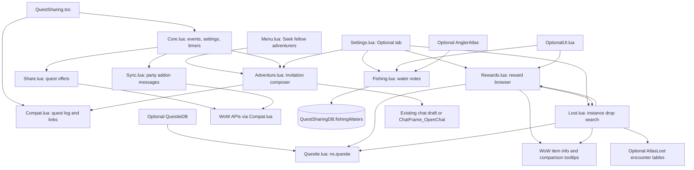
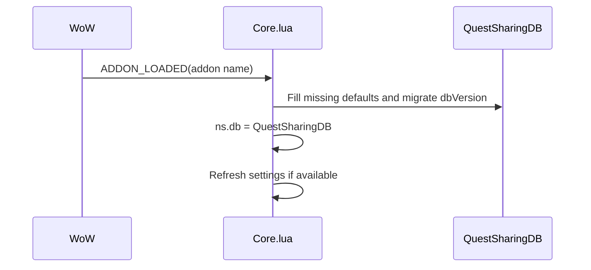
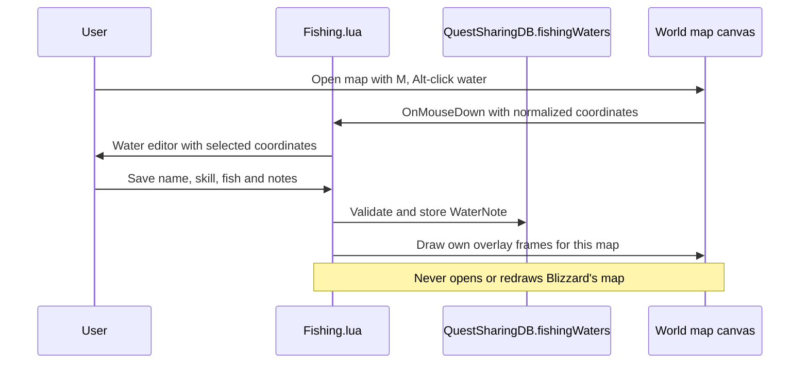
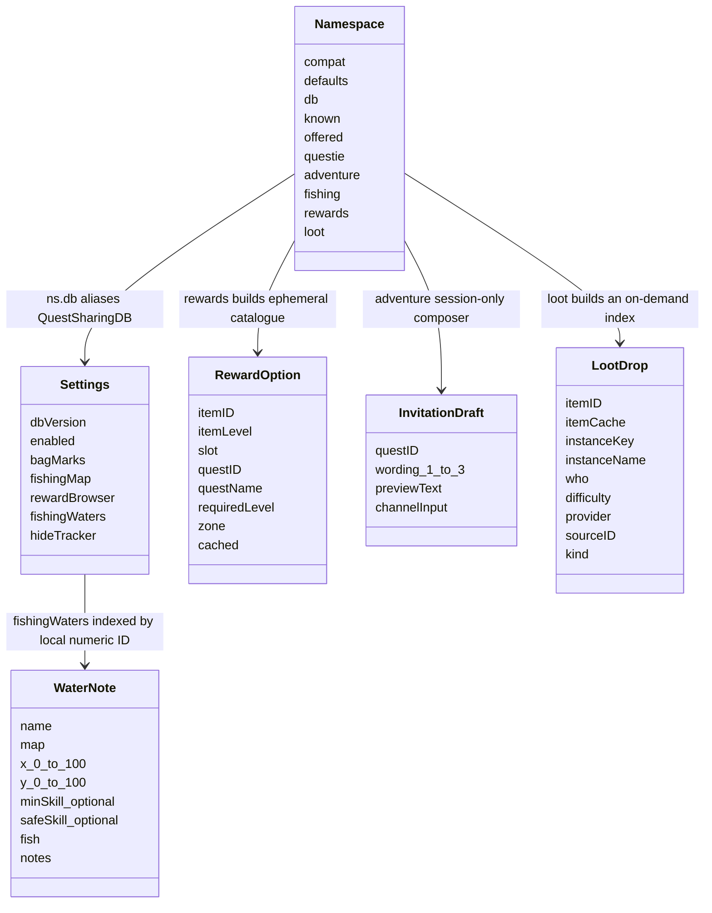

# Architecture
Last updated: 2026-11-13

## File tree
```text
QuestSharing/  # Repository root
├── .gitignore  # Exclude caches and release output
├── CHANGELOG.md  # Release history
├── QuestSharing/  # WoW addon runtime
│   ├── Adventure.lua  # Role-play quest invitation preview and chosen-channel chat drafts
│   ├── Bags.lua  # quest items marked in your bags, so you only carry what this zone needs
│   ├── Bindings.xml  # Game key bindings
│   ├── Compat.lua  # one place that knows the differences between the classic and the modern quest APIs
│   ├── Core.lua  # settings, timers, events, chat helpers and the /qs commands
│   ├── Diagnostics.lua  # an error log and a "doctor" report, so problems on a real game client are easy to report
│   ├── Friends.lua  # add the people you group with to your friends list
│   ├── Fishing.lua  # Optional world-map water notes, editor and AnglerAtlas zone summaries
│   ├── Highlight.lua  # make quest objectives easier to find
│   ├── Loot.lua  # Equipment-only instance browser with AtlasLoot tables and partial QuestieDB fallback
│   ├── Marker.lua  # showing each other where you are
│   ├── Menu.lua  # the small menu a right click on a quest in the Party quests window opens
│   ├── MinimapButton.lua  # a small button on the minimap
│   ├── OptionalUI.lua  # Shared frames, edit boxes, scrolling, tooltips and read-only map directions
│   ├── Panel.lua  # shows which party members share your quests
│   ├── Ping.lua  # one key (or a click on the ring) pings the nearest creature one of your quests needs with the game's
│   ├── Progress.lua  # notices when the objectives of one of your quests are all done, tells the party
│   ├── QuestItems.lua  # quest items you can USE (a torch to light, a flare to throw...)
│   ├── QuestSharing.toc  # Addon metadata and module load order
│   ├── Questie.lua  # if the Questie addon is installed, its quest database tells us where a quest starts and which quests
│   ├── Quick.lua  # a quick-chat wheel
│   ├── Rewards.lua  # On-demand QuestieDB reward catalogue, eligibility filters and item comparisons
│   ├── Settings.lua  # the settings window.   /qs settings   (also: the minimap button, the "Settings" link on the Party quests
│   ├── Share.lua  # notice a new party, push the quests of the area one by one, read the game's replies
│   ├── Status.lua  # what to say about a quest you click in the tracker, and the hooks that notice the click
│   ├── Style.lua  # one look for every window of the addon (settings, Party quests, reports)
│   ├── Sync.lua  # party members who also run Quest Sharing tell each other exactly which quests they have
│   ├── Team.lua  # "Picked up [Wolves Among Us] - Anna has it too. Want to do it together?"
│   └── Track.lua  # keeps the quest tracker (the list on the right) filled with the quests closest to you
├── README.md  # User documentation
├── build_release.py  # Build install ZIP and release notes
├── context/  # Session continuity and live architecture
│   ├── BUGS/  # Verified bug methodology and regressions
│   │   └── 2026-11-13-instance-loot-non-equipment.md  # Equipment filtering reproduction and fix
│   ├── architecture.md  # Live source map and runtime diagrams
│   ├── decisions.md  # Choices and rationale
│   ├── insights.md  # Timestamped findings
│   ├── schema.md  # Data structures and formats
│   └── state.md  # Current task and handoff
└── tests/  # Python tests and Lua API harness
    ├── harness.py  # Mock WoW APIs and load Lua addon
    ├── test_adventure.py  # Invitation generation, chat routes, preview and draft preservation
    ├── test_bags.py  # Tests for bags
    ├── test_box.py  # Tests for box
    ├── test_done.py  # Tests for done
    ├── test_emotes.py  # Tests for emotes
    ├── test_extras.py  # Tests for extras
    ├── test_features.py  # Tests for features
    ├── test_friends.py  # Tests for friends
    ├── test_highlight.py  # Tests for highlight
    ├── test_items.py  # Tests for items
    ├── test_log.py  # Tests for log
    ├── test_loot.py  # Instance loot parsing, search, provider fallback and asynchronous item names
    ├── test_look.py  # Tests for look
    ├── test_menu.py  # Tests for menu
    ├── test_optional.py  # Optional tool integration, water persistence, reward eligibility and comparisons
    ├── test_ping.py  # Tests for ping
    ├── test_questmap.py  # How-to quest text and retired map-overlay guards
    ├── test_questsharing.py  # Tests for questsharing
    ├── test_quick.py  # Tests for quick
    ├── test_ringtest.py  # Tests for ringtest
    ├── test_settings.py  # Tests for settings
    ├── test_team.py  # Tests for team
    ├── test_together.py  # Tests for together
    ├── test_tracker.py  # Tests for tracker
    ├── test_triggers.py  # Tests for triggers
    ├── test_where.py  # Tests for where
    └── test_zone.py  # Tests for zone
```

## Flowchart


## Sequence diagrams





```mermaid
sequenceDiagram
    participant User
    participant Rewards as Rewards.lua
    participant Items as QuestieDB ItemDB
    participant Q as Questie.lua
    participant Game as WoW item APIs
    User->>Rewards: Open browser
    Rewards->>Items: GetAllIds; read 100 items per timer batch
    Items-->>Rewards: Equipment and questRewards links
    Rewards->>Q: Read quest level, class/race masks and starter
    Rewards->>Game: Get item details for eligible rewards
    Rewards->>User: Filtered and paginated equipment
    Game-->>Rewards: GET_ITEM_INFO_RECEIVED
    Rewards->>User: Debounced refresh of cached item details
    User->>Rewards: Hover item / click quest
    Rewards->>Game: Item and equipped comparison tooltip
    Rewards->>User: Starter coordinates and prerequisite route
```

```mermaid
sequenceDiagram
    participant User
    participant Menu as Menu.lua / Core.lua / Settings.lua
    participant Adventure as Adventure.lua
    participant Compat as Compat.lua
    participant Chat as WoW chat edit box
    User->>Menu: Right-click quest; Seek fellow adventurers (row 2)
    Note over User,Menu: Directly after Tell the party how I am doing; also qs adventure / Optional
    Menu->>Adventure: open quest invitation
    Adventure->>Compat: Read unfinished quest and link
    Adventure->>User: Editable invitation, wording and channel
    User->>Adventure: Prepare chat
    Adventure->>Compat: Revalidate unfinished quest
    Adventure->>Chat: Preserve active draft or open chosen channel
    User->>Chat: Press Enter to send
```

```mermaid
sequenceDiagram
    participant User
    participant Loot as Loot.lua
    participant Atlas as AtlasLoot ItemDB
    participant Questie as Questie.lua
    participant Game as WoW item APIs
    User->>Loot: Open instance drops
    Loot->>Atlas: Read installed DungeonsAndRaids encounter tables
    alt Compatible AtlasLoot data available
        Atlas-->>Loot: Instances, encounters, difficulties and item IDs
    else No compatible encounter catalogue
        Loot->>Questie: Enumerate item drops from instance NPC/object spawns
        Note over Loot,Questie: Label coverage as partial
    end
    Loot->>Loot: Index up to 100 rows per timer batch
    Loot->>Game: Load up to 10 item details per timer batch (Rewards.itemInfo)
    User->>Loot: Filter instance, encounter or item/boss text
    Loot->>Loot: Require recognized weapon or wearable slot; hide unknown items
    Loot->>User: Paginated equipment with supplier and difficulty
    Game-->>Loot: GET_ITEM_INFO_RECEIVED
    Loot->>User: Debounced equipment classification and name refresh
```

## Class diagram
The addon uses Lua tables and a shared namespace; these are data relationships, not declared classes.

