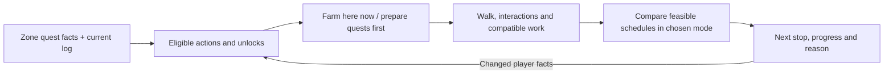

# Predictive zone quest planning

Design and worked example, 2026-11-17. The example uses invented quests and timings so anyone can reproduce the comparison. It is not a guide for the live Westfall map.



## The roadside decision

Separate **accepting**, **doing the work**, and **handing in** a green quest. Accepting from someone you pass can save a trip even when the best time to farm is later. A kill before acceptance earns zero credit on an acceptance-gated objective. A verified inventory item that counts retroactively is different. A prerequisite can require a parent to be active, accepted at some point, completed in the log, or handed in. Preserve the actual condition in each case where the data distinguishes it.

Compare two feasible remaining schedules from the same snapshot, both with the same completion goal. One works at the camp now. The other first accepts or unlocks quests that could share the work, then returns. Compare total travel, expected farm time, interactions and waits across the **whole remaining schedule**. Mandatory work already present in both plans cancels out. Defer only when the second plan is cheaper on the available evidence. For a green roadside pickup with a free slot and an objective unrelated to future work, the same comparison can favor immediate pickup. Difficulty color alone never answers this question.

## Facts, state and legal transitions

| Representation | Data and use |
|---|---|
| Character snapshot | Zone, position, level, faction, class, race, completed IDs, active log/progress, free log slots, inventory and eligibility observations with a timestamp. Speed, travel abilities and discovered flight links refine travel estimates when available. |
| Zone catalogue | Search the current outdoor zone and its submaps. Include quests outside the player's log, then evaluate character restrictions. An out-of-zone prerequisite, objective or hand-in is an external dependency with its known destination. It must not add another zone to this route. |
| Quest | ID, available starters/finishers, reward XP if known, repeatability, eligibility predicates, AND/OR prerequisites, alternative branches and exclusions. Store provenance per fact. |
| Objective | Quest ID, objective identifier/type, remaining quantity, eligible creature/item/object/event IDs, camp coordinates, credit gate, inventory consumption, and source/drop evidence. Identical text or overlapping map pins are insufficient to establish shared credit. |
| Travel and action costs | Edges between stops carry travel time and evidence. Actions carry interaction, combat, loot, respawn and waiting time where observed. An estimate based on straight-line distance can cross a river or cliff. |
| Search state | Current stop, simulated active and handed-in sets, completed objectives, remaining slots, target set and accrued time/XP. For a stochastic objective, predict its cost and use actual game counters to observe its completion. Queue alternatives never change the real log or inventory. |

Track completed, active, available now, unlockable in this zone, conditionally inaccessible, and permanently ineligible separately. Unknown facts are meaningful. An unknown reputation requirement or a missing source does not prove permanent ineligibility. Only evidence such as a verified class restriction can do that. Record cycles, incompatible choices and unverified external links separately from completed or intentionally skipped quests. Reassess a level-gated quest when the actual player levels. A future-level forecast requires verified XP thresholds, rewards and eligibility data.

A pickup consumes a slot, an objective needs its own credit gate, and a hand-in frees a slot and awards XP. Generate successors only if their prerequisites hold in the *simulated* state. Simulate an escort as an uninterrupted sequence when its constraints are known. If validation of an unusual objective, event, prerequisite or exclusivity relationship fails, withhold that prediction and show which fact is missing.

## Objectives and costs

| Mode | Compare feasible alternatives by |
|---|---|
| Complete the zone, default | Complete all locally attainable non-repeatable quests. If branches conflict, maximize compatible quest coverage and then minimize expected time. Show exclusive alternatives, blocked and unknown quests. The user may explicitly restrict the difficulty range. |
| XP per hour | Maximize known quest XP divided by elapsed time over a nonempty route ending in a hand-in, including preparation time. Repeatable grinding and unknown XP require separate evidence. On ties prefer more known XP, then less time. |
| Selected quests | Complete the requested IDs and the prerequisite work they need in the least expected time. Identify incompatible or unreachable selections. An empty selection cannot implicitly mean “complete everything.” |
| Time budget | Maximize the number of distinct hand-ins within the budget, then minimize expected time. With uncertain drops an expected-time budget is a forecast. A hard deadline would require a specified probability or a conservative bound, and may be impossible to guarantee. |

For a schedule, expected total seconds equal travel plus expected elapsed time of the action groups plus non-overlapping waits. Count only the incremental cost when the same action advances multiple accepted quests. Two actions at the same coordinates can share a walk even if their service time and credit are separate. A visit near the straight line connecting two waypoints is an opportunity to compare, not proof of a walkable road.

For one verified creature population, a remaining kill quota (k), and one active item quota (r) with constant independent one-item drop chance (p>0), let (T_r) be the number of kills to obtain (r) items. The camp requires (\max(k,T_r)) kills. An exact finite expression avoids simulating thousands of loot rolls:

```math
E[\max(k,T_r)] = k + \frac{1}{p}\sum_{j=0}^{\min(k,r-1)} (r-j){k\choose j}p^j(1-p)^{k-j}.
```

After the first (k) kills, each still-missing item costs (1/p) further kills in expectation. Multiple verified kill quotas on the very same event take their maximum. More than one different loot requirement needs the joint drop and credit law. A supplied joint distribution can be evaluated with a small dynamic program over remaining counters, or calibrated sampling against a fixed error budget. Otherwise keep estimates separate, label uncertainty and avoid promising simultaneous loot credit. For two demands on the same consumable stack, reserve the required units for each hand-in unless sharing is verified. A distinct named creature, nonmatching credit ID, unavailable spawn phase, gated item or unknown source cannot inherit another quest's progress.

## Search and replanning

| Strategy | Strength and limit |
|---|---|
| Nearest currently legal action | Fast baseline and an immediately feasible order. It can farm before picking up a quest that needs the same mobs. |
| Short lookahead | Branch on a few legal pickups, unlocks and camp visits. Better local decisions, but a hard depth cut can miss a distant prerequisite. |
| Zone-wide dependencies with bounded schedule search | Build legal relationships across the zone first. Compare alternative orders including unlock-first and work-now and keep a feasible incumbent. Limit branching and work per frame, and replan when observations change. The best explored route is a heuristic result. |

With (n) independent actions, there can be (n!) orders. Even a single-visit deterministic subset dynamic program requires up to (O(n 2^n)) states before quest gates, stochastic counters and inventory. Use a bounded search, prioritize candidates that can share a camp or unlock others, reuse local source lookups, and time-slice work in the existing scheduler. For small fixtures, calculate exact overlap and compare alternative full schedules independently. Search costs depend on the actual state/branch budgets and the number of local actions; a work slice limits UI blocking, not total completion time. Preserve a legal fallback when search quality is uncertain and surface any unresolved objectives.

An accepted/abandoned quest, confirmed prerequisite change, level-up, material inventory change, or observed objective completion invalidates affected successor actions. Recompute the route suffix from the current position using cached zone facts. A slight movement or one unlucky roll alone offers little evidence. With fixed independent drop chance, a dry streak leaves the expected time to the *next* drop unchanged. Re-estimate only if observations change the remaining count, show persistent evidence for a different model, or the player reports a blocked/contested camp. Actual game counters always win. For soft changes, retain the current step unless the improvement exceeds switching cost and estimate error. For a now-illegal step, replan immediately. Keep the optional guide asleep at login and when closed; avoid full-database reads on movement or per-frame arrow updates.

## Executed eight-quest simulation

The automated fixture in tests/test_quest_optimizer.py uses eight invented local quests. It runs through the actual Lua optimizer with both supported client API styles.

| ID | State and actions |
|---|---|
| A / 1 | Active. Kill 10 camp creatures and hand in at the hub. |
| B / 2 | Missing from log. Accept at hub, collect five items from those creatures at an estimated 25% drop chance, hand in at hub. |
| C / 3 | Locked behind D's hand-in. Accept at hub, kill eight of those creatures, hand in at hub. |
| D / 4 | Available at hub. Inspect the watchpost and return to unlock C. |
| E / 5 | Available green quest at hub. Inspect a marker on the road to camp and hand in at hub. |
| F / 6 | Available at hub. Talk at the watchpost and return. |
| G / 7 | Available at hub. Inspect orders at the watchpost and return. |
| H / 8 | Available at hub. Inspect a dispatch at the watchpost and return. |

Player starts at camp. Coordinates on one symmetric road are camp 0.0, marker 0.2, hub 0.4 and watchpost 0.6. Travel costs 100 seconds per coordinate unit. Each pickup, hand-in and independent inspection costs 3 seconds. Each kill including loot takes 10 seconds. No competing players or respawn delay, and there are 25 log slots. Quests share verified personal kill credit and a single quest item drop stream in this fixture.

Executed predictive order follows these physical actions.

1. Travel camp → hub. Accept B, D, E, F, G and H.
2. Travel hub → watchpost. Complete D, F, G and H.
3. Return to hub. Hand in D, accept C, hand in F, G and H.
4. Travel toward camp. Complete the independent green marker E on the way.
5. At camp, kill until A, B and C are satisfied together.
6. Return to hub and hand in A, B, C and E.

The nearest-ready baseline starts by killing ten creatures for A before B/C are accepted. It subsequently accepts missing quests, unlocks C and farms B/C together. It receives the same simultaneous-progress credit for quests already active. Both routes complete the same eight quests.

| Measured solver quantity | Nearest-ready | Predictive |
|---|---:|---:|
| Hand-ins | 8 | 8 |
| Travel | 160 s | 160 s |
| Independent interactions | 60 s | 60 s |
| Expected kills | 30.01849365 | 20.09471893 |
| Expected total | 520.18493652 s | 420.94718933 s |

The forecast saves 99.23774719 seconds under the explicit fixture assumptions. The test calculates the overlap expectation independently using Python binomial probabilities, validates every prerequisite edge, and checks equal completed coverage. If C instead requires A's hand-in, the same engine keeps their kill work sequential and the fixture requires at least 28 expected kills.

An added cost unique to preparation, such as unavailable quest pickup or a newly required detour, must exceed the saved farm time to make working now cheaper. Travel already mandatory for both schedules does not count as that added cost. A costly camp can be reported as busy for five minutes in the guide, causing the next schedule to price an explicit wait. Unsupported joint loot laws use separate service estimates.

## Current implementation and limits

- QuestOptimizer.lua consumes atomic per-quest actions and checks dependencies, log slots, exclusions and acceptance windows. It evaluates a nearest-ready incumbent, shared-camp preparation schedules, up to 12 terminal-goal alternatives and the prior route, with at most 36,000 alternative candidate checks. It yields through DataWork between actions and batches. This is bounded constructive search over the zone graph.
- The default includes all known attainable local non-repeatable quests. The Plan button exposes complete-zone, quest-XP/hour, selected IDs and expected-time-budget goals. Difficulty color is an optional explicit green/yellow filter.
- Counts use live objective matches or labelled provider/description evidence. Unknown work is priced at 60 seconds per task and flagged. Combat defaults to 10 seconds per kill and interactions to 3 seconds. These estimates need in-game calibration.
- One loot stream plus compatible kill quotas uses the stated exact expectation. Different loot streams use separate estimates. This conservative estimate may miss profitable shared farming.
- Native map dimensions and movement speed scale geometric travel. Missing map dimensions use a labelled illustrative 3000 × 2000 yard scale. SPF can refine currently legal first-leg costs asynchronously. Later legs remain geometric estimates.
- Visible quest/level/bag/spell events rebuild from zone caches. Movement is sampled every three seconds while the guide is open and can replan after a meaningful displacement or speed change. The previous feasible action order survives improvements of at most ten estimated seconds. Closed/login/combat workers remain suspended or cancelled.
- Quests gated by a future level appear with their current requirement and recheck on level-up. The engine does not simulate unverified future XP thresholds, inventory consumption/capacity, flight/transport routes, reputation changes, custom escort state or statistical learning of drop rates. These facts require additional verified provider/live adapters before they can govern speculative transitions.
- Full Questie eligibility is still the source of acceptance judgments. Missing judgments are reported. The database can differ from live Forever behavior, which requires in-game confirmation.
- Plan choices and goals are session-local. The guide and report show which scope is in use.

## Delivery and verification

1. **Normalize real quest facts.** Test live remaining versus database counts, percentages versus probabilities, log capacity, exclusions, unavailable objectives and signed prerequisites. Carry evidence and mark missing fields. Never synthesize credit from a translated mob name.
2. **Build legal action schedules.** Emit separate pickups, objectives and hand-ins, preserve ordering/branch semantics, and keep external work visible without a worldwide route. Check a locked quest, an active-parent quest, a full log and an impossible selection.
3. **Compare costs before farming.** Run the eight-quest comparison, a no-overlap counterexample, an expensive-detour variant and all four goal modes. Expected time/credit must change when the corresponding input changes. Same-location independent work can share travel without reducing service cost.
4. **Connect the guide.** Show a named current action, upcoming stops, objective progress and a reason tied to the two schedules actually compared. Keep waypoint selection, map markers and arrow consistent when replanning. A direct bearing alone does not establish road or terrain access.
5. **Check in-game behavior and performance.** Exercise the route with current Forever data, including missing quantity, uncertain eligibility, irregular drops, an off-route diversion and combat/guide close. Verify zero catalogue work at login and when closed, bounded frame work on open and no oscillation on minor movement. Compare elapsed time and actual player choices with the forecast before interpreting model estimates as observed savings.

### Failure cases

A stale Classic prerequisite on Forever, incorrect credit sharing, consumed inventory counted twice, a fast map line over an impassable cliff, changed spawn density, or an unresolved branch can each make a cheaper-looking route slower or impossible. Report the problem at its own level: unknown eligibility, external work, estimated travel, unverified credit or stale progress. Known local work should remain available when one forecast fails. A finite search may miss a better route even with perfect input.

## 2026-11-17 — Coverage audit against the supplied brief

The design discusses all ten requested deliverables. Runtime coverage remains partial.

| Brief area | Implemented | Remaining |
|---|---|---|
| Four separate objectives | Complete-zone, quest-XP/hour, selected IDs and expected-time budget scoring | Forecast quality depends on known costs/XP, compatible branches and bounded search |
| Player/world state | Position, current level, log/progress, history checks, speed, provider eligibility and exposed log capacity | Inventory quantities/consumption/bag capacity, known flight links, travel abilities, spawn density and respawn estimates |
| Dependency network | Unaccepted zone quests, local chains without a fixed depth, signed prerequisites, accepted/active/hand-in gates, exclusions, external/unknown reports | Predict simulated level/reputation/skill changes, distinguish every unusual completion gate, compare every OR-prerequisite alternative by total cost |
| Predictive Murloc decision | Compare preparation first with immediate work, price one loot stream plus compatible kill quotas, prevent pre-acceptance credit | General joint distributions for several loot streams, consumed-item allocation and special credit rules |
| Search | Nearest incumbent plus bounded alternative schedules, prior-route stability, explicit estimates | Broader state search may improve quality; no global optimum is established |
| Replanning | Quest/progress/level/bag/spell events and meaningful movement, user-reported temporary camp wait | Learn drop/combat/respawn models, detect crowding or newly discovered missing-giver facts automatically |
| Instructions/explanations | Guide actions/progress, arrow/map stops, report and measured cost comparisons | Native Forever rendering/data/timing validation |
| Simulation/design | Eight-quest executable test, independent probability oracle, same-work nearest comparison, failure cases and design discussion | Additional real-zone calibration and unusual objective fixtures |

Earlier use of “implementation complete for verified local data” describes the supported core. It does not establish full implementation of every capability requested in the brief.

## Plan to complete the predictive quest algorithm

Start with one decision the player can check. At a green quest giver on the road, compare accepting now and doing the work now, accepting now and doing the work later, and returning for both later. Include the trip back, log space, item eligibility, chain unlocks and final hand-ins in each comparison. A quest can be omitted only when the selected goal permits it or a constraint prevents it. Show the constraint when the omission is forced.

| Phase | Deliverable | Acceptance test |
|---|---|---|
| 1. Define the goal and baseline | Keep the four objectives independent. Default to all attainable local non-repeatable quests in minimum expected time. For mutually exclusive branches, maximize compatible completions before minimizing time. XP mode maximizes expected XP per hour with an explicit list of XP sources. Selected mode includes prerequisite work. Budget mode maximizes completed hand-ins within the stated expected-time budget. Apply the optional green/yellow filter visibly. | On the same zone snapshot, score each mode independently. Every default-mode omission has an eligibility, conflict, scope, missing-data or search-limit reason. Selected quests that cannot coexist are identified by name. |
| 2. Establish the facts available on this client | Inventory the actual WoW Forever, Questie and optional travel-provider fields. Record identity, units, map, source, observation time and confidence for each consequential fact. Build a zone catalogue including unaccepted quests, alternate givers and camps, chains, restrictions, rewards and known outside-zone requirements. Classify quests as completed, active, available, locally unlockable, conditionally inaccessible, permanently ineligible or unknown. | For a Westfall snapshot, every suggested stop has a local position. A remote hand-in, missing quest giver, wrong-class restriction and uncertain reputation rule each produce distinct explanations. Conflicting Classic and live evidence can be traced and the live observation prevails for the current character. |
| 3. Simulate character state and legal actions | Extend the search state with XP toward the next level, reputation, skills, log slots, carried stacks, bag space, reserved and consumed items, learned travel abilities and cooldowns. Model pickup, objective completion and hand-in as separate transitions. Preserve every legal OR prerequisite and exclusive branch until the search evaluates it. Apply level, race, class, faction, skill, reputation, completed-in-log, accepted and handed-in gates at the transition that needs them. | A nearer valid OR parent wins over a distant lower-ID parent. A hand-in can free the last log slot or cross a known XP/reputation threshold. One stack cannot pay for two hand-ins. A quest explicitly requiring an active parent closes when the parent is handed in. Unknown reward or threshold data leaves the unlock conditional. |
| 4. Model work and shared progress | Define the credit event and activation rule for each kill, loot, talk, explore, interaction, use-item, named enemy, escort and scripted event. Track progress gained before acceptance only where item or quest rules establish it. Keep the exact single-drop calculation. For multiple drops with known joint outcomes, calculate expected remaining work over the outstanding item counts and kill quotas. Use bounded sampling for larger models. With only marginal drop rates, compare plausible bounds and expose uncertainty when it changes the choice. Treat escorts and timed events as uninterrupted actions where required. | Two active kill quests can share one kill. A locked follow-up receives zero credit. Independent, mutually exclusive and correlated loot tables give distinct costs under otherwise identical inputs. Pre-owned items, full bags, two claims on one item and a failed escort each change the simulated state correctly. |
| 5. Price travel, combat and waiting | Compare walking to each viable spawn or giver with verified local flight and travel-ability alternatives. Include access, cooldown, cast, transit and destination-to-objective time. Incorporate terrain-aware walking when available and label geometric estimates. Price camp work with eligible spawn density, observed fight/loot time, respawn delay and competition. Count waits overlapping travel or other work only once. | A cliff can reverse the straight-line choice. A learned flight wins only when the entire trip is faster. A cooling-down ability, sparse camp or crowded spawn can make the roadside quest preferable now. An external travel requirement stays visible at the zone boundary. |
| 6. Search complete alternatives within a frame budget | Seed the search with the existing nearest-legal schedule and predictive schedule. At consequential decisions branch on pickup now/later, alternate prerequisites, camp, travel method and work now/later. Rank partial schedules by the selected objective and a forecast of the remaining zone. Keep a bounded beam of distinct feasible states and the best complete schedule found. Merge states only when all future-relevant facts, including inventory and cooldowns, agree. Use exhaustive search on tiny fixtures as an independent reference. | Both schedules in the roadside comparison start from identical facts. In complete-zone mode they cover the same required work, or report the coverage difference first. Under the same cost model the chosen result scores at least as well as the feasible baseline. Record search-budget exhaustion and measured gaps to the tiny-fixture optimum. |
| 7. Replan from observations and explain the result | Observe quest acceptance/completion, item gains and consumption, level/reputation/skill changes, meaningful movement, travel unlocks, newly observed givers, and camp availability. Learn rates only from attributable opportunities, including eligible kills yielding zero items. Qualify sparse samples and retain manual camp-wait input. Re-evaluate an invalid step immediately. For a still-valid step, change it when the forecast improvement exceeds switching cost and estimate uncertainty. Show the next action, position and progress. Explain deferrals with the actual competing quest, prerequisite and estimated time difference. | A rare item removes work immediately. One unlucky kill leaves a well-supported route stable. Repeated attributable evidence or a camp closure can change it. The guide can explain “take this roadside quest now, farm after picking up B” and give the opposite instruction when returning costs more. |
| 8. Validate correctness, cost and responsiveness | Keep the eight-quest fixture as the reference case. Run the greedy, predictive and small exact solver against identical snapshots, goals and cost assumptions. Exercise both client API styles and replay real Westfall observations. Measure login and closed-guide catalogue reads, per-frame planner time, memory, cancellations and route changes while moving, looting and in combat. Validate guide text, arrow and pins against actual in-game stops. | Reproduce the existing fixture at eight hand-ins, 160 seconds of travel and about 20.09 versus 30.02 expected kills. Reverse the preferred action with an expensive unlock or an unavailable pickup. Add fixtures for every gate, resource and probability case above. Confirm zero planner catalogue scans at login or while closed, and record measured in-game timing and frame impact. |

**Delivery sequence.** Establish phases 1–2 first. Character-state transitions in phase 3 supply the legal moves for both the objective model and the travel model. Develop phases 4–5 against those same transitions, then integrate search and replanning. Run each phase's acceptance tests as soon as it is available. Finish with the full simulation, replay and native-client checks in phase 8.

**Completion condition.** For each requirement, record the provider or live observation that supports it, the corresponding search decision and a passing scenario. If the client cannot expose a fact, document the affected quests, fallback and remaining uncertainty. Keep unsupported capabilities and outstanding in-game checks open in the coverage audit.

## Coding backlog for the quest tool

Use the existing TOC-loaded optimizer, guide and automated Lua harness as the starting point. Each numbered change is a reviewable implementation batch. The names below refer to current modules and functions. Ship each change through the normal `/qs plan` entry point.

1. **Capture the inputs for one plan generation.** Extend `Questie.lua` (`plannerQuest`, `plannerTargets`) and `Compat.lua` to read evidenced prerequisite semantics, quest rewards, required/consumed items, character XP and reputation, carried item counts, available stack space and log slots. Read the character snapshot once in `QuestPlanner.lua` and pass it to `planOptions`. Only query items relevant to local candidates. Store units, source and unknown values explicitly. Test both API styles, absent providers, bank exclusion and unsupported Forever fields in `test_planner_facts.py`.

2. **Keep alternate unlock paths alive.** Change `newCandidate`, `buildGraph` and `questActions` in `QuestPlanner.lua`. Today candidates blocked by level leave the graph early and the graph selects one OR parent. Retain conditional local candidates and pass the complete AND/OR gate groups, active-parent windows and exclusive choices to `QuestOptimizer.compile`. Update selected-mode dependency discovery so it permits alternative parents without forcing all of them. Test a distant low-ID parent against a cheap higher-ID parent, a cycle with a legal escape, a closed acceptance window and an external prerequisite.

3. **Apply state changes in the simulator.** Extend `newState`, `eligible` and `advance` in `QuestOptimizer.lua`. Every simulated pickup, work action and hand-in must update the right resources exactly once. Apply verified XP, reputation and skill changes, inventory reservation/consumption, bag-space and log limits. Make a newly satisfied gate eligible at the correct step. Revalidate the next predicted pickup against live facts on arrival. Test a hand-in that unlocks the next level, an exactly full log, and two quests competing for the same item stack.

4. **Finish objective credit and farming costs.** Extend `plannerTargets`, `questActions`, `farmAt` and `service`. Give each action a source, credit event, acceptance rule and interruption/consumption behavior. Handle multiple loot requirements with verified joint outcomes and preserve the existing single-stream calculation. Price plausible bounds when the joint distribution is unknown. Add explicit talk, use-item, escort, named-enemy and event transitions wherever the provider supplies the rule. Verify correlated and exclusive drops, pre-owned items, escort interruption and zero retroactive credit.

5. **Add actual travel choices.** Extend `QuestPlannerPath.lua` and the travel callback from `planOptions`. Preserve viable alternative camps and givers currently reduced to a nearest point. Compare walking with learned flights and available travel abilities using access time, cooldowns, transit and exit time. Carry the winning travel method and intermediate boarding/cast steps into the route. Cache costs per zone and capability snapshot, and guard delayed provider callbacks with the plan generation. Test a cliff, an unknown flight, a cooling-down ability and a slower flight after access time is included.

6. **Upgrade route search.** Extend `compile`, `attempt` and `optimize` in `QuestOptimizer.lua` to branch on the retained prerequisite, camp, travel and work-timing choices. Seed with the current feasible route. Carry distinct simulated states through a bounded beam, use each goal's scoring rules, yield via `DataWork.lua`, and retain the best complete incumbent if the budget expires. Price both roadside alternatives from the same starting state. Build a tiny exhaustive reference solver in the test harness and compare feasibility, quest coverage and time for all four goals. Keep the existing eight-quest fixture as a regression.

7. **Wire observations and explanations into the guide.** Extend the visible-session event handlers and `explainPlan` in `QuestPlanner.lua`. Attribute eligible kills, zero-drop opportunities, loot gains, combat duration, observed respawns, newly encountered givers and camp availability to matching local facts. Coalesce changes and update the affected schedule using cached data. Avoid learning from ambiguous observations. Keep the chosen alternative, competing alternative, cost difference and confidence in the optimizer report. Display those in the current step or its details and send the chosen next physical stop to `QuestGuidance.lua`. Test an invalidated step, a stable route after one unlucky kill, a changed plan after sufficient evidence, and closing the guide during pending work.

8. **Verify and package a playable preview.** Run `test_planner_facts.py`, `test_quest_optimizer.py`, the planner UI/path/guidance suites and `test_data_budget.py`, then the full Lua harness and TOC compilation. Build a local installable ZIP and validate its contents. Exercise a real Westfall route under both travel-provider configurations, record actual time versus forecast, verify guide text/waypoints, and profile login, combat, movement and closed-guide work. Record unsupported provider data and native checks still pending before calling the full tool finished.

**Implementation order.** Complete batches 1–3 first because both shared work and travel consume the simulated character state. Batches 4 and 5 can then proceed independently. Batch 6 integrates their choices, batch 7 connects real observations and player feedback, and batch 8 validates the resulting addon. Run each batch's focused tests before the next dependent change.

## Implementation progress — 2026-11-17

Follow-up: complete OR gate groups now reach the simulator, and selected-mode tests choose the cheaper parent without including the other branch. QuestieDB reputation and skill requirements are parsed; local native reputation snapshots and Forever skill-line ranks gate pickups, while known quest reputation rewards update the simulated state at hand-in. UPDATE_FACTION and SKILL_LINES_CHANGED trigger visible-session replanning. Focused facts24/24 and optimizer32/32 pass; full workspace46 suites/1,731 checks and 44 Lua modules compile. This does not complete the eight-batch plan: dynamic skill gains, source-item consumption, joint loot distributions, flight/travel methods, beam/exact search, attributable cost learning, native Westfall validation and preview packaging remain open.

Later follow-up: small plans (up to 40 atomic actions) now use a bounded beam after seeded feasible routes; all four goals use their score to rank branches. A six-action fixture matches independent exhaustive enumeration for all four goals, and an OR cycle with a local escape remains routable. The eight-quest all-mode run keeps eight hand-ins, 420.95 seconds and 4,013 alternative checks without budget exhaustion. Two active item quests at one camp now report their unknown joint drop probability and a plausible two-stream kill range. Full workspace46 suites/1,741 checks and 44 Lua modules pass; local byte-verified playable preview is `dist/QuestSharing-predictive-preview-2026-11-17.zip` (46 files, 256,672 bytes, SHA256 `a359711defd6621c988badcc7cdf41302ccb09ad7378e79ebf6ae7b312d0af4c`). Native Westfall and performance checks remain unavailable without a game client; joint-loot distributions and bounds beyond two streams, large-zone beam, flight/ability options and attributable learning remain open.

Coding backlog steps 1 and 3 have a first integrated resource-state increment. The normal guide reads relevant carried bags on demand, passes current XP/level/free slots to the optimizer, and models explicit item gains and consumption. A one-level quest unlock can enter the route only when the live XP threshold and known local quest XP support it. Equal completed coverage now ranks by expected time. Focused cases cover both client API styles, carried versus bank items, one-stack double spending, full bags, and an XP threshold. Full workspace suite passes 1,719 checks and 44 Lua modules compile.

The remaining acceptance cases in steps 1–8 stay open. In particular, consumed-item rules need verified Questie/Forever provenance before the live catalogue can populate `consumedItems`, and level advancement beyond one known threshold waits for a new live observation. Alternative OR prerequisites, reputation and skill transitions, travel methods, multi-loot distributions, live cost learning and native-client validation have not passed their completion tests.
