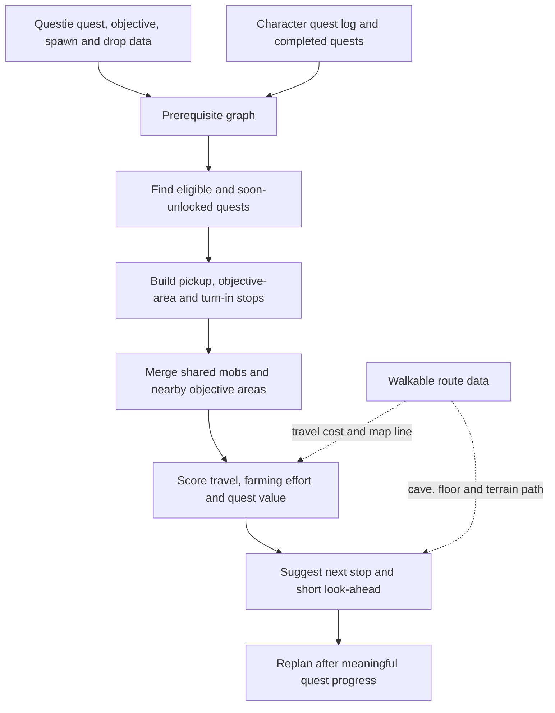

# WoW quest optimization research
Last updated: 2026-11-16

## Purpose

Research whether Quest Sharing could recommend an efficient order for quests in a zone, including prerequisites, shared mobs/objectives, nearby quest areas, and item drop chances. This is research and a design starting point; no optimizer has been implemented.

## Finding

The idea is feasible, and several addons already explore parts of it. The closest match to the proposed *quest tree plus grouped work* is Dreamway's prerequisite-aware quest batching. QuestFlow and QuestRoute optimize active objectives as live geographic stops. QuestTrail describes a more ambitious player-data-driven planner with walking paths. Factoruide documents a full simulated leveling-route optimizer.

The useful model is a **prerequisite graph plus route stops**, not a strict tree. Prerequisite links can be shared, and some chains permit alternative prerequisite quests. A route can group actions only once the relevant quests are available/accepted.

## What other projects do

| Project | Public evidence | Useful idea | Limit or caution |
|---|---|---|---|
| [Dreamway Quest Planner](https://github.com/CirdanTheCodewright/Dreamway-Quest-Planner) | Public GitHub repository and LGPLv3 CurseForge release; uses Questie data. Its web app lets a player view quest chains and make ordered journey batches; its in-game tracker shows the current batch. | Strong match for the user's example: do prerequisite chains first, then group the quests that can be worked in the same area. It also records a character's actions so the route can be reviewed on a map. | The route is player-authored in batches, not a fully automatic best-route solver. It is still an instructive interaction and data model. |
| [QuestFlow](https://github.com/Madie69/QuestFlow) | Public GitHub project; its README labels it beta and targets WoW Forever interface 16001. | Re-evaluates the active quest log; combines nearby objectives from different quests into geographic stops, keeps all objective names visible, and routes turn-ins as their own stop type. | Appears focused on active quests and Blizzard POIs, rather than planning an entire prerequisite graph. Its documented grouping uses normalized map-distance thresholds. |
| [QuestRoute](https://github.com/orwick12/QuestRoute) | Public GitHub repository with a pure-Lua `Router.lua` and test harness documented in its README. | Routes pickups, objectives and turn-ins; orders stops with nearest-neighbor followed by 2-opt; shows drop chance per source and can account for low chances; sweeps nearby camps. This is a small, readable starting point for route-order heuristics. | The README explicitly says its arrow is straight-line and can point across water/mountains; dungeon objectives are not routed yet. It also reads some Questie internals, so upstream changes can break it. |
| [QuestTrail](https://www.curseforge.com/wow/addons/questtrail) | Active WoW Forever addon; release page lists v4.5.0 on 2026-11-15. Developer describes a community-built planner and shares learned quest/world data. No public source-code repository was found during this review. | Quest clusters camps as areas, groups touching areas, and can move a whole outing (pickup, objective work, hand-in) together. Its map/path display and dynamic look-ahead closely match the desired user experience. | Claims such as measured time savings are project-reported, not independently verified here. Source repo not located, so it is not a code reference for now. |
| [Factoruide](https://github.com/brouznouf/factoruide) | Public GitHub repository; MIT application code, while its bundled quest database has a separate GPL-3.0 license. An extensive [`ARCHITECTURE.md`](https://github.com/brouznouf/factoruide/blob/main/ARCHITECTURE.md) explains the algorithm. | Most detailed algorithm reference: simulate time for travel, fighting, loot/drop chances and XP; respect prerequisites/exclusive quests; generate an initial greedy or region route, then improve it with local search. Stops can be moved or grouped when doing so saves travel. | It optimizes a whole leveling run toward a target level, which is much larger than Quest Sharing's first zone-level feature. Reusing code/data requires license review. Its documented baseline also estimates some in-zone walks straight-line, so it does not solve terrain routing by itself. |
| [Questify](https://github.com/questify-addon/questify) | Public GitHub project for WoW Forever; QuestieDB is required and Shortest Path Forever is optional. | Shows a practical authored route, quest prerequisites, optional branch/bag quests, step progress and routing-provider integration. Helpful for deciding how a plan can stay readable and editable. | Primarily a prepared route/guide, not a live optimizer that discovers the best order from all zone quests. |

## Public discussion

- Dreamway's description explicitly frames batches as a way to work multiple quests in the same area while respecting prerequisites and reducing backtracking: [CurseForge project description](https://www.curseforge.com/wow/addons/dreamway-quest-planner).
- QuestTrail's public release notes describe grouping objective camps and whole quest outings, and keeping an existing route stable when quests are accepted in a different order: [QuestTrail 4.4.0 notes](https://www.curseforge.com/wow/addons/questtrail/files/9613298).
- Community posts for QuestTrail discuss route scoring by XP per second including travel, A* walking paths, and player-contributed map/quest evidence: [QuestTrail 4.0 discussion](https://www.reddit.com/r/WowUI/comments/1xntk1t/questtrail_40_dynamic_selfupdating_questing/).
- A recent perspective argues that optimizing every detour can reduce the exploration that makes old WoW questing enjoyable: [PC Gamer on questing in WoW: Forever](https://www.pcgamer.com/games/world-of-warcraft/im-so-glad-im-not-using-a-questing-addon-in-world-of-warcraft-forever/). This supports keeping the planner advisory and letting the player ignore or pin a route.

## Drop chances

- Questie has a per-item/per-NPC drop-rate lookup in its runtime (`QuestieDB.GetItemDroprate(itemId, npcId)`), backed by DropDB: [Questie source](https://github.com/Questie/Questie/blob/master/Database/QuestieDB.lua#L2902-L2916).
- QuestieDB's basic item fields (`npcDrops`, `objectDrops`) are source IDs; they do not themselves contain the chance. Drop-rate support is a separate data path and can return no value.
- QuestRoute demonstrates one use: display rates, prefer a higher-chance source, and allow the player to filter out very low chances. Factoruide uses drop chance to estimate how many kills an objective may take.
- Rates should be treated as estimates tied to game flavor/version and source. Unknown should remain unknown; never silently interpret no rate as zero chance.
- Quest Sharing currently does not call the drop-rate lookup. Its `Q.targets()` helper caps some alternative sources (`MAX_SOURCES = 3`), so a future optimizer should query the complete source data or extend its data access rather than treating that display helper as exhaustive.

## Proposed first version for Quest Sharing

1. **Build the quest graph.** Index quests and prerequisite links. Treat `preQuestSingle` as an any-of branch and `preQuestGroup` as all-of dependencies. Track the character's completed, active and available quests so already-finished branches are removed and newly unlocked quests can be planned.
2. **Represent work as stops.** A quest can have a pickup, one or more objective areas, and a turn-in. A stop may cover objectives from several quests. Keep pickup and turn-in actions visible even when objective stops are merged.
3. **Only combine work that can count.** For the bear example, finish the three prerequisite quests first; once the follow-up quest is open, accept it and the independent bear quest before farming, then count bear kills and tooth drops toward both. If the follow-up is not yet available, show it as a future unlock, not as current work.
4. **Use shared mobs first, proximity second.** Strong evidence is identical NPC/object IDs or overlapping spawn camps. If no objectives overlap, group nearby areas as a travel-saving outing. Do not merge merely because two quests are in the same zone.
5. **Score effort, not only map distance.** Prefer known walkable-path time when available. Estimate farming effort from required counts and per-source drop chances; include pick-up/turn-in detours and optionally level/XP value. Label uncertain costs and data gaps.
6. **Plan a short horizon and stay stable.** Show the next stop plus a few upcoming grouped stops. Recalculate after accepting/finishing/turning in quests or entering a new zone, but preserve the player's chosen/pinned stop and avoid changing the route for minor objective counter updates.
7. **Keep it advisory and inspectable.** Explain why stops are grouped (“same bears count for 2 quests”), what must be completed first, and when a drop rate/location is unknown. Let the player skip, pin, or ask for a refresh.

## Fit with current Quest Sharing code

- `QuestSharing/Questie.lua` can read quest starters, prerequisite fields, kill/item/object/explore objectives, item drop-source IDs, NPC/object spawns, map IDs and turn-ins.
- The current data adapter feeds quest display and directions, not a complete route optimizer. In particular, some helper functions deliberately cap alternate sources.
- `context/walkable-routing-research.md` and `context/shortest-path-source-study.md` cover terrain routes, floors and the external Shortest Path Forever code. Quest ordering and walkable route geometry are separate problems that can be combined behind a route-cost interface.
- First prototype should be zone-local, only use already accepted/available quests and immediately unlockable prerequisite chains, group verified shared targets, then use geographic distance as fallback. Add global XP/time simulation only if a later need justifies its complexity.

## Sources reviewed

- [QuestieDB public API](https://github.com/Questie/QuestieDB/blob/master/docs/api.md) and [support-data guide](https://github.com/Questie/QuestieDB/blob/master/docs/support-data.md).
- [Questie `GetItemDroprate` implementation](https://github.com/Questie/Questie/blob/master/Database/QuestieDB.lua#L2902-L2916).
- [Dreamway Quest Planner](https://github.com/CirdanTheCodewright/Dreamway-Quest-Planner), [CurseForge release/details](https://www.curseforge.com/wow/addons/dreamway-quest-planner).
- [QuestFlow](https://github.com/Madie69/QuestFlow).
- [QuestRoute](https://github.com/orwick12/QuestRoute).
- [QuestTrail](https://www.curseforge.com/wow/addons/questtrail) and its [4.4.0 notes](https://www.curseforge.com/wow/addons/questtrail/files/9613298).
- [Factoruide route optimizer](https://github.com/brouznouf/factoruide) and [algorithm architecture](https://github.com/brouznouf/factoruide/blob/main/ARCHITECTURE.md).
- [Questify](https://github.com/questify-addon/questify).
