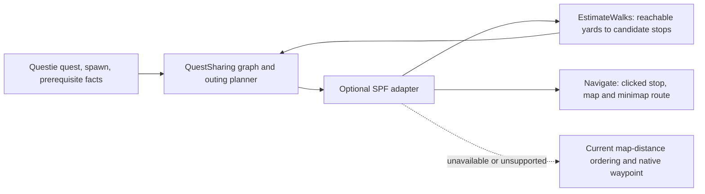

# Quest planner routing and validation plan
Last updated: 2026-11-16

## Current integration — 2026-11-17
- **Superseded 2026-11-17 (decouple run r-20261117-234605-6ba9, decisions D5):** the planner no longer calls `EstimateWalks`; it plans with straight-line travel only, identical with or without SPF. `QuestPlannerPath.lua` offers only `available()` and `follow()` (→ `Navigate`) for the explicit Follow button. The walk-cost bullets below and "Phase 2" are history.
- QuestOptimizer now owns schedule selection. The SPF bridge refines legal first-leg costs and queues a guarded cooperative recost, preserving action gates.
- Whole-outing promotion remains a tested adapter helper. The live planner now uses atomic schedule costs and consecutive display grouping.
- Current design and limits are in predictive-quest-optimizer.md.

## Implementation status — 2026-11-16
- Implemented locally: optional `QuestPlannerPath.lua`, soft TOC ordering for SPF, explicit Follow with SPF and `/qs plan follow`, same-map asynchronous walk estimates chunked at 256, cancellation and stale-result guards, plus whole-outing promotion while preserving dependency edges.
- The provider is not bundled. Without the supported API, Quest Sharing keeps its straight-map-distance outing route and native waypoint. Only the first outing is promoted by SPF walking costs; the rest of the itinerary is still approximate.
- Added `tests/test_quest_planner_path.py`; adapter and planner integration checks pass 10/10. All 35 scripted suites pass (1,324 checks); changed Lua files parse and `git diff --check` passes.
- Still pending: live WoW verification with SPF absent/present, obstacles, map/minimap drawing, another active journey, and cave/floor cases.

## Goal
- Keep the quest plan, prerequisite logic, outing grouping and panel inside Quest Sharing.
- Optionally use the installed Shortest Path Forever (SPF) engine for walkable route guidance and walk-distance estimates.
- Continue working without SPF; never describe a straight-line estimate as a walkable path.
- Do not copy or bundle SPF code or navigation data. Call its public addon API only.

## Finding: the current public API can do more than draw
- `ShortestPathForever.API.EstimateWalks(owner, from, targets, callback, opts)` asynchronously returns on-foot route yard-costs from one start to multiple candidate destinations on the same walking map. It has a 256-target request limit, cancellation, and combat/loading/no-data/unreachable outcomes.
- `Navigate` / `NavigateRoute` hands destinations to SPF, which owns its route line, map/minimap display and turn guidance. `Guidance()` exposes the current walking leg's route bends if Quest Sharing later needs to read them.
- API docs currently report version 2, minor 3. `EstimateWalks` is a minor-3 addition; integrations must check API version and function presence rather than assuming every installed SPF build has it.
- SPF route estimates are useful on-foot costs; `EstimateWalks` does not include journeys, transport, hostile-town avoidance or road preference. Water handling follows the supplied option/player state; do not promise strict dry-land-only routes.
- Source: [SPF addon API](https://github.com/cjber/shortest-path-forever/blob/main/docs/api.md), [API types](https://github.com/cjber/shortest-path-forever/blob/main/types/API.lua), [SPF repository](https://github.com/cjber/shortest-path-forever).

## Proposed architecture

### Phase 1 — click-to-follow walkable guidance (implemented locally)
- Add a small `QuestPlannerPath.lua` adapter; no hard TOC dependency or copied code/data.
- Show an explicit **Follow this stop** action when a compatible `Navigate` API exists. A row click continues to select the stop; the new action starts guidance only after an intentional user click.
- Convert existing `map, x, y` planner points (0–1) directly to SPF's coordinate format. Send an explanatory title and supported stop kind. Continue using the game's waypoint fallback when SPF/API is absent or refuses the request.
- Do not automatically replace a journey owned by SPF, another guide or the player. Read `Journey()`/`CurrentStop()` and require the explicit Follow action to hand off; cancel only Quest Sharing's own route.
- For each selected objective stop, keep Quest Sharing's plan as the source of truth. SPF supplies the current walk/transport guidance; quest acceptance, progress, zone changes and turning the planner off retain existing behavior.
- Don't set SPF's `npc` field initially: it can mark that NPC's nameplate and objective spawn points may include several NPCs. Don't invent `z`; pass height only when Questie or a verified API lookup provides it.

### Phase 2 — use walk costs to improve stop ordering (first outing implemented locally)
- If `EstimateWalks` exists, request costs from the player's current point to the first dependency-ready stop of each outing on the current walking map.
- Promote the outing with the lowest finite reachable yard cost as the first trip. Keep the existing prerequisite/dependency ordering intact and leave later outing/stop ordering on the existing map-distance heuristic.
- Leave whole-outing comparison on the current heuristic in the first pass. A full directional stop-to-stop cost matrix can require one asynchronous search per source and grows quadratically; measure real zones before paying that cost.
- If SPF is missing, old versions lack `EstimateWalks`, or the map has no SPF data, label the plan as approximate and use the existing map-distance fallback. If a supported SPF search explicitly returns a stop unreachable, do not count that as a valid walkable route; display that route data is unavailable/unreachable and keep the stop selectable for manual use.
- Cancel pending requests on a newer plan generation, zone change, planner disable and replacement request. Ignore stale callbacks by generation token. Keep the last good ordering while a new asynchronous estimate is loading.
- Limit and chunk requests to 256 targets; reject mixed map targets before calling SPF. Handle callback costs as `false`, `nil`, zero or missing entries without treating zero as absent or unreachable.

## Dedicated automated tests to add before runtime changes
- New file: `tests/test_quest_planner.py`, using the existing Lua 5.1 `Game` harness and both modern/classic game styles where applicable.
- Adapter API detection: SPF absent; malformed API; versions 1 and 2; future version; v2 without minor-3 `EstimateWalks`; and `Navigate` missing/refusing.
- Inputs: normalized coordinates, invalid maps/coordinates, exactly 256 targets, >256 chunking, and a target on another map.
- Search results: callback arrives later; reachable costs; zero cost; false/unreachable; overall `combat`, `loading`, `nodata`, `outside`, `offmesh`, and `error`; malformed/missing cost entries.
- Lifecycle: second request cancels first; zone/quest refresh invalidates stale result; disable cancels; callback fires after a newer generation; a manual stop action does not steal a journey until clicked.
- Routing: dependencies remain ordered when measured costs disagree; unreachable stays visible but isn't claimed as walkable; without SPF the current approximate order and native waypoint still work.
- Existing baseline all 34 scripted suites / 1,314 checks must remain green via the repository's documented per-file runner.

## In-game verification checklist
1. Run without SPF: planner still opens, orders by approximate map distance and sets native waypoint; UI says approximate.
2. Run with current SPF: click Follow this stop; map and minimap draw the route and SPF tracker/arrow guides to it. Confirm the owner is Quest Sharing and taking a later stop changes only that route.
3. Confirm using another guide first: opening/replanning Quest Sharing doesn't replace that journey; an explicit Follow click has a clear, expected ownership result.
4. Validate obstacles: Goldshire-to-Stormwind gate, lake/bay detour, mountain pass and road/cross-zone boundary. Compare route bends and reached destination with in-game terrain.
5. Validate floors: an outdoor cave entrance, a quest NPC inside a cave (including Azurelode-style overlapping hill/mine surfaces), multi-floor city, and a destination with no height. Confirm the route doesn't choose a surface from 2D coordinates alone; otherwise mark floor guidance unavailable and retain only the objective marker.
6. Exercise SPF loading, no-data, unreachable, combat, turning SPF journeys off, map changes, planner disable and `/reload`; ensure no stuck spinner, stale callback or claimed path.
7. Verify SPF's water-walking behavior against the user's intended walking mode. If the user needs no swimming at all, don't enable a route labeled walkable until a reliable setting/API control exists.

## Acceptance criteria
- Quest Sharing remains usable with SPF absent and no third-party code/data is bundled.
- Every on-foot path shown as SPF guidance comes from SPF, not a straight line between endpoints.
- Route order obeys prerequisites; measured cost only chooses among currently valid stops.
- Explicit SPF unreachable/no-data results are never silently described as a proven traversable path.
- Cave/floor claims are limited to destinations whose surface is verified by live data; unknown height stays visibly uncertain.
- The new harness covers asynchronous cancellation and safe fallback, then the full documented suite passes.
- No release until real client checks pass on both SPF-installed and SPF-absent configurations.

## Risks and open limits
- SPF's API/version and behavior can change; detect capabilities at runtime and preserve fallback.
- Estimated walking lengths alone do not solve full multi-stop route optimization; exact whole-outing ranking would need pairwise costs or SPF journey estimates and deliberate performance limits.
- Questie spawn coordinates often lack height. SPF's cave/floor support cannot infer the correct cave level from an arbitrary 2D point in every case.
- No WoW client is available in this workspace, so map drawing, API handshake, real Questie data and cave-floor correctness remain pending live verification.

## 2026-11-16 — v0.4.18 panel and arrival follow-up
- QuestPlanner now filters by WoW's green/yellow quest difficulty colors, explains an all-gray zone, and shows local pickups line by line by giver, including when no matching quest is active.
- Pickup/route rows set a waypoint on left-click and also mark the location on right-click. The player opens the World Map normally; the addon does not call protected map-opening/navigation APIs.
- The planner can be dragged without later docking resets. Wrapped rows and the scroll child size to measured text. A source-shape mismatch in starter discovery was fixed with `nearestSource()`.
- The 6-case planner UI workflow and 10-case SPF path suite pass; the full suite passed 36 files / 1,330 checks. Published as v0.4.18 from commit `30b3118`; release asset SHA256 `b28424148cbf7370d553bab55dbed2e9cf0a8774ae7b979cf58c4bc8a65afd93`. Actual map/window rendering and WoW API behavior remain unverified until live client checks.
