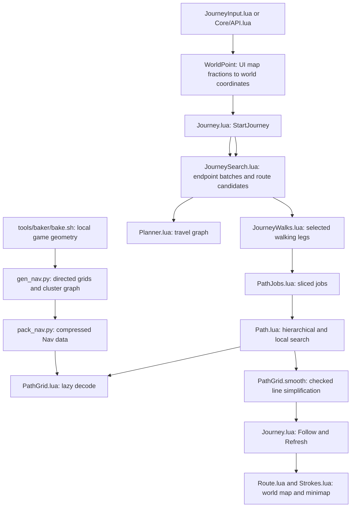

# Shortest Path Forever — source study
Last updated: 2026-11-14

## Scope and evidence
- User: "so learn how he does it"; study the implementation, not merely the external integration API.
- Traced the main generation → input → search → drawing → replan flow in public source at `bc9eaa96154c319a3ab7ef30433e73b2c6b86839`.
- Source inspected through GitHub connector, pinned raw file reads; snippets selected by function boundaries and call sites. Not a whole-repository audit.
- Read related test assertions; did not execute upstream tests or launch a WoW client. No QuestSharing runtime edits or third-party code/data copied into the addon.
- Parent feasibility/documentation review: `context/walkable-routing-research.md`.

## Source map
```text
shortest-path-forever/  # External reference, not installed in this repository
├── tools/baker/bake.sh  # Pin and patch TrinityCore; build extraction tools; start bake
├── tools/baker/gen_nav.py  # Convert Detour polygons to directed grids and cluster graph
├── tools/pack_nav.py  # Compress and package generated Lua into Nav/
├── Nav/  # Bundled generated walkable terrain, lazy decoded
├── Data/Heights.lua  # Extra spawn heights for overlapping surfaces
├── Core/API.lua  # Validate/copy external stops; route ownership; call StartJourney
├── Journey/JourneyInput.lua  # Quest/map destination selection, map-to-world conversion, spawn heights
├── Journey/Journey.lua  # Goal, progress, driver, guide and replanning triggers
├── Journey/JourneySearch.lua  # Endpoint costs, multimodal candidates, refinement and publication
├── Journey/JourneyWalks.lua  # Shared per-leg geometry searches/cache and deferred geometry
├── Journey/Hazards.lua  # Zone/town preferences while choosing a route
├── Routing/Planner.lua  # Journey graph: walking, flights, boats, portals, teleports
├── Routing/PathGrid.lua  # Decode grids, floors/directed movement, endpoint snapping, smoothing
├── Routing/Path.lua  # Local A*/Dijkstra, abstract A*, refinement, cost queries
├── Routing/PathJobs.lua  # Coroutine job queue, shared frame budget, cancellation/combat deferral
├── Routing/Floor.lua  # Infer player's possible floor from movement through connected surfaces
├── UI/Canvas.lua  # Own overlay frames; read map state without acquiring native map pins
├── UI/Route.lua  # World/minimap painters, pooled native lines, geometry revisions
└── UI/Strokes.lua  # Projection, clipping, breadcrumb spacing, reusable geometry buffer
```

## Verified flow


```mermaid
sequenceDiagram
    participant Input as API.NavigateRoute / PlanQuest
    participant Journey as Journey.StartJourney
    participant Search as JourneySearch
    participant Walks as JourneyWalks
    participant Path as PathJobs + Path
    participant Draw as Route + Strokes
    Input->>Input: Validate map/coordinates; choose destination/floor
    Input->>Journey: StartJourney(world point)
    Journey->>Search: Start(goal, previous route, progress, Follow)
    Search->>Path: FindMany endpoints / FindCost candidate walks
    Path-->>Search: Settled costs and bounds, across frame slices
    Search->>Search: Compare walking and transport alternatives
    Search->>Walks: Prepare chosen walking geometry
    Walks->>Path: Find(map, from, to, callback, water mode, hazards)
    Path-->>Walks: Smoothed points, weighted cost, heights/wet distance
    Walks-->>Search: Geometry ready / deferred / error
    Search-->>Journey: Publish usable/refined route
    Journey->>Draw: SetJourneyRoute(destination, legs)
    Draw->>Draw: Project, clip, draw pooled line/dot regions
    Journey->>Search: Replan when position/options warrant
```

## 1. Build terrain data offline
- `bake.sh` builds four pinned/patched TrinityCore tools: mapextractor, vmap4extractor, vmap4assembler, mmaps_generator; checks hazards/drops, then calls trinity.py. Tools and generated files stay outside the game install.
- `gen_nav.py:2–19`: read Detour tiles; identify global connected components; rasterize neighboring tile windows; assemble directed floor-aware grids; generate cluster graph. Convert Detour (west, up, north) vertex storage to UnitPosition's north/west world axes.
- `gen_nav.py:50–72`: ADT tile 1600/3 yards, 67 cells per side (about 7.96 yards/cell). Swimming yard weight **3**, water walking **1**. This is a preference cost, not an assertion that swimming is literally 3x slower.
- `gen_nav.py:171–180`: reject underwater/hazard-floor flags; retain appropriate ground/steep/water polygons. Disconnected terrain without fixed-place anchors and small components are pruned.
- `gen_nav.py:grid_hpa`: group border crossings by strongly connected regions and direction. Keep sampled entrances; precompute within-cluster Dijkstra costs for both water modes. PRUNE=1.02 permits dropping an edge with a two-hop alternative within 2% under each weight. This does not imply a global 2% optimality guarantee.
- Data is necessary, not incidental: transplanting only a Lua A* function supplies no knowledge of walls/mountains/lakes.

## 2. Resolve destination and floor
- `JourneyInput.lua:PlanQuest`: native quest POIs / next waypoint feed `Planner.QuestDestination`. Complete quests prefer turn-in POI over a stale last-objective waypoint. No usable location → report unavailable, rather than inventing one.
- `WorldPoint` calls `C_Map.GetWorldPosFromMapPos(uiMapID, CreateVector2D(x,y))`; input fractions 0..1 become a world-map ID and world x/y.
- `Core/API.lua:NavigateRoute`: validate/copy all stops before replacing guidance, then `StartJourney`. Optional z, npc, quest areas and owner identity are significant.
- `JourneyInput.lua:SpawnHeight` uses `Data/Heights.lua` near multi-surface NPC spawns. Recorded example: Azurelode Mine miners otherwise route to the hill over the mine. Undercity UI map has an underground height hint.
- `Floor.lua`: client player height is described as placeholder zero on this build. Track candidate surfaces through legal movement, settle when only one floor remains, otherwise preserve uncertainty. Unknown height cannot simply be equated with ground level.

## 3. Search legal movement, then travel options
- `Path.lua:run`: require map data; locate/snap start and goal with height; connect endpoints to cluster entrances; reject disconnected endpoints; abstract A* over entrance graph; refine hops into local grid routes.
- `Path.lua:search`: local A* for one goal or Dijkstra for many targets; legal step masks, floor links, heights and direction constrain expansion. Water/road/hazard factors determine route choice. Separate accumulated choice cost and real weighted distance are kept.
- `PathGrid.lua:steepStep`: a step involving a steep node permits only destination height <= source height. Directed links preserve drops without allowing the reverse climb.
- `Planner.lua`: separate higher-level graph of walking legs, flights, docks, portals and teleports. Baked fixed-place costs plus measured endpoint searches supply walk weights; schedules/waits affect arrival time. Consecutive walking legs may not be split to manufacture a straight-line shortcut around a measured barrier.
- `JourneySearch.lua`: bounded start/goal FindMany searches, candidate probes, refine known routes; first usable route can be shown while alternatives continue. Geometry for later remote-continent walks is deferred while retaining known costs.
- `Planner.WalkPoints` is a two-point preview when geometry is pending/deferred. Do not present that preview as a proved traversable path. A failed search can hide its geometry; existing geometry can be retained on refresh.

## Cave / multi-level follow-up — 2026-11-14
- Re-read complete Floor.lua and floor_spec.lua, stop_floor_spec.lua, height generator and input/API height lookup after user asked specifically about cave quests.
- Three separate requirements: retain overlapping walkable surfaces and legal links; identify destination surface; identify player's current surface. Same x/y does not imply connected floors.
- `tools/gen_heights.py`: height catalogue is generated from pinned CMaNGOS classic-db creature and quest-related object world x/y/z, matched to walking surfaces by bake_heights.lua. Retain spawns near an alternative surface separated by more than ZTOL. Generator currently selects maps **0 and 1**, not universal Forever/custom-zone coverage.
- `API.NavigateRoute`: explicit stop.z wins; otherwise auto SpawnHeight lookup happens only when stop.npc is supplied and no map-specific height exists. A generic waypoint/native quest input is not automatically guaranteed the right cave floor; missing height can choose the cheapest surface.
- `Floor.Sample`: candidate-floor tracking narrows via legal connected movement, with swimming hints. Teleports/large jumps/loading discontinuities, taxi rides and lift proximity can discard floor inference. Floor.Height returns nil if ambiguity remains; a reload inside stacked floors may need movement to resolve.
- `tests/floor_spec.lua`: source assertions require an underground goal not count reached from known ruins-floor height above it; **when player floor is unknown, horizontal position alone can count as arrived**. This is an explicit caveat, not complete floor certainty.
- Azurelode Mine comments document the actual hill-versus-miners failure motivating extra spawn height. Cave graph support does not prove correct targeting for every cave quest; no live test performed.

## 4. Smooth without reintroducing obstacles
- `PathGrid.smooth`: collapse collinear steps, then attempt farther visible points.
- `sight` walks the candidate segment cell by cell via legal neighbor transitions, requiring the correct final floor. Reject blocked/illegal steps, road-policy breaks, worse hazard exposure and over-budget water/travel cost.
- A lake/bay detour must survive line simplification: a prettier straight line across the water must not replace the land route unless the searched route itself used the water and the cost constraint allows it.

## 5. Keep work bounded and lifecycle correct
- `PathGrid.lua`: shared path work budget 2 ms, graph cache ceiling 4 MiB, decoded grid ceiling 24 MiB, cluster count ceiling 64/map; active coroutine locals are additional. These are configuration targets, not guaranteed total frame/memory limits.
- `PathJobs.lua:pump`: round-robin coroutine slices; restore each job's scratch; cancellation suppresses callbacks; combat waits for PLAYER_REGEN_ENABLED; idle releases scratch and trims decoded data.
- `Journey.lua:Update`: progress about every 0.1 s; replans periodically and on ride/run-speed changes. `JourneySearch.Replan` refreshes costly endpoint searches when off-route, after stale costs, water-mode changes and changed travel options.
- `JourneySearch.Worthwhile`: settled-route replacement generally requires 30 seconds or 10% gain (whichever threshold is smaller), with separate initial/provisional handling. Avoid jitter from continuously choosing a marginally different route.

## 6. Render the same route in two coordinate systems
- `Route.SetJourneyRoute` transforms legs into ordered point lists; painters consume shared geometry.
- World map: map bounds/world-to-map conversion, zoom/view clipping and screen-size-aware breadcrumb spacing.
- Minimap: subtract player position, convert north/west to east/north, rotate by player facing when rotateMinimap is enabled, divide by minimap view radius, clip to round/square edge. Off-screen goal waits on rim.
- `Strokes.lua` is pure geometry; `Route.Paint` uses pooled WoW `CreateLine` regions with dark underlines and dot textures. Reuse stroke buffers/regions; hide leftovers; don't allocate endlessly each update.
- Minimap redraws up to ~10 Hz while changing and reduces polling while still. Route geometry revisions invalidate projections.
- `Canvas.lua` uses own overlay frames and reads native map state to avoid protected/gamepad pin side effects; no reason to restore retired QuestSharing map pin code.

## Existing test cases inspected (not executed)
- `tests/path_spec.lua`: Goldshire → Stormwind must go via gate; Dun Algaz tunnel route; Loch Modan land detour vs Water Walking crossing; Darkshore bay smoothing must preserve dry middle segments; canal floor checks; cancellation and sliced/synchronous equivalence.
- `tests/path_direction_spec.lua`: downhill-only steep steps; ledge drops local/across cluster boundaries; reverse-batch direction; old format compatibility.
- `tests/strokes_spec.lua`: constant breadcrumb spacing, clipping, bounded stroke count, reused buffers, minimap rotation and goal projection.
- These are stronger evidence than feature text, but source assertions are not evidence of a passing local run or live-game accuracy.

## Lessons for QuestSharing
- Existing `Questie.lua` supplies destination candidates; route cost must eventually replace normalized 2D proximity when choosing among spawns.
- A self-contained implementation is technically possible: bundle maintained generated terrain and implement/adapt search, floor handling, scheduling and projections. It is substantially more work than a public API bridge.
- The study is not authorization to add a dependency or copy/vendor source/data. If implementation is requested, choose between optional provider integration and an internally bundled router; any direct reuse must preserve upstream licensing/attribution obligations.
- No claim of strict dry-land-only mode, exact continuous shortest path, safe routes past all live enemies, all dungeon interiors, or complete current-client terrain coverage.
- Prototype validation must include actual mountain pass, lake detour, cave/overlapping floor, bridges, turn-in, missing data, cancellation and map/combat behavior.

## Primary code links
- [Baker](https://github.com/cjber/shortest-path-forever/blob/bc9eaa96154c319a3ab7ef30433e73b2c6b86839/tools/baker/gen_nav.py)
- [Path search](https://github.com/cjber/shortest-path-forever/blob/bc9eaa96154c319a3ab7ef30433e73b2c6b86839/Routing/Path.lua)
- [Grid and smoothing](https://github.com/cjber/shortest-path-forever/blob/bc9eaa96154c319a3ab7ef30433e73b2c6b86839/Routing/PathGrid.lua)
- [Floor inference](https://github.com/cjber/shortest-path-forever/blob/bc9eaa96154c319a3ab7ef30433e73b2c6b86839/Routing/Floor.lua)
- [Frame scheduler](https://github.com/cjber/shortest-path-forever/blob/bc9eaa96154c319a3ab7ef30433e73b2c6b86839/Routing/PathJobs.lua)
- [Journey search](https://github.com/cjber/shortest-path-forever/blob/bc9eaa96154c319a3ab7ef30433e73b2c6b86839/Journey/JourneySearch.lua)
- [Map drawing](https://github.com/cjber/shortest-path-forever/blob/bc9eaa96154c319a3ab7ef30433e73b2c6b86839/UI/Route.lua)
- [Projection and strokes](https://github.com/cjber/shortest-path-forever/blob/bc9eaa96154c319a3ab7ef30433e73b2c6b86839/UI/Strokes.lua)
