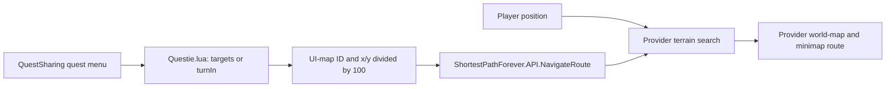

# Walkable quest routing feasibility
Last updated: 2026-11-14

## Request and conclusion
- 2026-11-14 clarification: user wants documentation specifically about **WoW pathfinding implementations**, not general pathfinding papers. Prioritize Forever terrain baker/API, WoW movement-map generation/debugging, and namigator documentation; general literature is background only.
- Research only: draw a traversable route from the player to quest objectives/turn-ins on the world map/minimap, avoiding impossible mountain/lake shortcuts.
- Feasible for the project's Forever client using **Shortest Path Forever** as an optional routing provider; no runtime changes made.
- QuestieDB supplies destinations, not a general walkable terrain graph. Building equivalent routing from scratch is substantially more work than integrating the existing provider.
- Recommendation: an explicit quest-menu routing action under an optional Extra tools feature, default off, delegating calculation/rendering to the provider. This is a proposal, not implemented behavior.

## Verified in QuestSharing
- `QuestSharing/QuestSharing.toc`: Interface 16001 (same as the inspected provider).
- `QuestSharing/Questie.lua`: `Q.targets(questID)`, `Q.turnIn(questID)`, `Q.spawnList(kind,id)`, `Q.uiMapOf(areaId)` already resolve quest destinations.
- Spawn shape: `{area, map, x, y, dungeon}`; `map` is a UI-map ID, x/y are percentages 0..100. Dungeon sentinel {-1,-1} is not a routable coordinate.
- `Q.nearest` compares squared normalized 2D coordinate separation on the current map. It does not establish walking reachability or travel cost.
- `Track.lua` uses `Compat.distanceSq` for ranking/pinning; it has no terrain pathfinder.
- Retired quest overlays remain removed. Existing protected-map constraints in `OptionalUI.lua` still apply; do not open/redraw Blizzard's protected map to implement a bridge.

## Primary sources inspected
- [QuestieDB public API](https://github.com/Questie/QuestieDB/blob/master/docs/api.md): entities, spawn positions and zone mappings.
- [QuestieDB NPC schema](https://github.com/Questie/QuestieDB/blob/master/src/meta/npcMeta.lua): `spawns` are NPC positions; `waypoints` are NPC movement paths, not a global player navigation network.
- [Shortest Path Forever download and usage](https://www.curseforge.com/wow/addons/shortest-path-forever): supports Forever; quest Plan journey action, modifier-click world map/minimap; dotted walking routes on both maps, replanning, transport combinations. Store listed v1.37.1-forever on 2026-11-14.
- [Provider features](https://github.com/cjber/shortest-path-forever/blob/main/docs/features.md): tunnels/city levels, water costs, danger preferences, routes to dungeon entrances.
- [Provider API](https://github.com/cjber/shortest-path-forever/blob/main/docs/api.md): `ShortestPathForever.API`, documented major versions 1 and 2; function capability checks required.
- [Terrain baker](https://github.com/cjber/shortest-path-forever/blob/main/tools/baker/README.md): build-time extraction from a local client with TrinityCore/Recast/Detour; compressed navigation data shipped in addon; player slope/step limits and overlapping floors.
- [Path search](https://github.com/cjber/shortest-path-forever/blob/main/Routing/Path.lua) and [grid](https://github.com/cjber/shortest-path-forever/blob/main/Routing/PathGrid.lua): hierarchical A*, 8-yard grids, Dijkstra batches, directed movement, water costs and constrained line smoothing.
- [Settings](https://github.com/cjber/shortest-path-forever/blob/main/UI/Settings.lua): independent world-map/minimap route visibility; Follow roads; avoid high-level zones; hearth/teleport policy.
- Source branch inspected 2026-11-14; observed main head `bc9eaa96154c319a3ab7ef30433e73b2c6b86839`. Branch and packaged release may differ; integration must verify the installed release contract.

## Shortest / walkable limits
- The planner optimizes estimated travel time and preferences, not necessarily minimum ground distance. Flights, boats, portals, teleports and lifts can be part of a journey.
- Water has a swimming cost; water walking affects it. Do not promise a hard no-swimming rule. Published Navigate/NavigateRoute API has no explicit walk-only, dry-land-only or allowed-modes argument.
- Follow roads can choose a longer walk; danger penalties can also change the chosen route.
- Hierarchical/finite grid data, endpoint snapping and dynamic game changes mean no claim of a mathematically exact shortest path or perfect obstacle coverage.
- Dungeon/raid interior goals are routed to their entrance; this provider does not establish navigation inside every instance.
- QuestieDB spawn locations generally lack height. Multi-floor objectives/caves can require an entrance or floor-aware destination; do not assume a 2D quest coordinate picks the correct floor.
- API Estimate explicitly omits endpoint terrain searches: useful for rough ranking, not proof that an exact objective point is reachable.
- No game client available; source/documentation feasibility verified, actual live compatibility and route accuracy untested.

## Proposed bridge contract (not implemented)

- Use `NavigateRoute("QuestSharing", stops)` or `Navigate("QuestSharing", map, x/100, y/100, title, kind)`; route stops can carry quest IDs, objective area radius, hold, and optional known height.
- Version-check supported major 1/2 and function presence; handle missing addon/loading/combat/invalid/unreachable without inventing a traversable straight-line fallback.
- Route to an unfinished objective, or turn-in when complete. Multiple spawn alternatives should eventually be compared by actual route cost; existing Q.nearest is only geometric.
- Preserve player/other-addon ownership: explicit initiation, CurrentStop/Ended/Subscribe for lifecycle, Cancel only the QuestSharing-owned route; avoid repeatedly replacing another guide's journey.
- Let provider render/replan. No need to bundle its large navigation dataset or recreate map drawing in QuestSharing.
- Strict dry-land-only walking would need a separately confirmed provider capability or API extension before offering that promise.

## Alternatives evaluated
| Approach | Feasibility | Fit |
|---|---|---|
| Shortest Path Forever optional bridge | High for Forever; live smoke test required | Best verified match: terrain routing and both map renderers already present |
| FarstriderLib + FarstriderLibData | Public API and Retail/Classic travel graphs available | [README](https://github.com/Deathwing/FarstriderLib) establishes waypoint/transport routing, not equivalent fine terrain coverage for Forever |
| Own offline-generated terrain graph + Lua search/rendering | Technically feasible; large dataset/toolchain/maintenance burden | Only justified if provider cannot satisfy requirements; QuestieDB alone is insufficient |

## Next verification if implementation is requested
- Install a matching provider release and required packaged dependencies; verify API version and actual route behavior.
- In-game scenarios: opposite sides of a lake, mountain barrier/pass, cave entrance, bridge/tunnel, completed quest turn-in, several candidate spawns, and dungeon entrance.
- Exercise combat/load deferral, missing provider, unknown/unreachable destination, another guide taking ownership, map zoom/rotation and moving off-route.
- Confirm whether fastest multimodal guidance is desired or a hard walking/no-swimming mode is required.

## Published research follow-up — 2026-11-14
- User asked whether research has been done, beyond addon implementations. Initial answer had established source/documentation feasibility, not an academic literature review.
- **Botea, Müller, Schaeffer (2004), Near Optimal Hierarchical Path-Finding**, Journal of Game Development: HPA* groups grid cells into clusters to accelerate large-map searches. Abstract reports up to 10x speed and paths within 1% of optimal in its experiments; these are not guarantees for WoW/provider output. [Author-hosted paper](https://webdocs.cs.ualberta.ca/~mmueller/ps/2004/hpastar.pdf), [author publication record](https://webdocs.cs.ualberta.ca/~jonathan/PREVIOUS/Papers/ai.2004.html).
- **Xiao Cui, Hao Shi (2011), A*-based Pathfinding in Modern Computer Games**, IJCSNS 11(1), 125–130: reviews A*-based approaches and navmesh vs waypoint representations; uses Halaa in WoW as an illustrative example via Tozour's earlier work, not a benchmark of current Forever. [University repository](https://vuir.vu.edu.au/8868/), [publisher PDF](https://paper.ijcsns.org/07_book/201101/20110119.pdf).
- Search-indexed primary text supplied abstracts/relevant passages; direct fetches of the two PDFs failed (publisher timeout/author-site redirect), so do not describe these as fully read papers.
- [Recast/Detour official introduction](https://github.com/recastnavigation/recastnavigation/blob/main/Docs/_1_Introduction.md): primary engineering documentation, not an academic paper. Navmeshes represent traversable collision-derived surfaces; slope/step/agent dimensions determine allowed movement; paths traverse polygons and are smoothed.
- [namigator](https://github.com/namreeb/namigator): WoW-specific open-source engineering project using Recast, terrain parsing, mesh generation and path queries for server-controlled movement on older clients. Not an in-game addon or a published validation of Forever.
- Conclusion: substantial established algorithm research plus WoW-specific implementations; no academic evaluation of Shortest Path Forever or guarantee of exact routes found in this focused search.

## WoW-specific documentation index — 2026-11-14
- **First: [Shortest Path Forever terrain baker](https://github.com/cjber/shortest-path-forever/blob/main/tools/baker/README.md)**: extracting Forever client geometry, generating walking maps, slopes/steps, liquids, floors, ledges, packaging and source provenance. Directly relevant to this addon's client and obstacle-aware walking.
- **Integration: [Shortest Path Forever addon API](https://github.com/cjber/shortest-path-forever/blob/main/docs/api.md)**: UI-map coordinates, Navigate/NavigateRoute, readiness/failure reasons, route lifecycle and ownership. Relevant to using the computed routes in QuestSharing.
- **Data/debugging: [stoneharry/mmaps-for-custom-maps](https://github.com/stoneharry/mmaps-for-custom-maps)**: original author's guide for WoW 3.3.5/TrinityCore maps, vmaps and mmaps; generating/debugging pathfinding tiles and visual path tests. Emulator documentation, not a live-addon API.
- **Independent WoW implementation: [namigator](https://github.com/namreeb/namigator)**: old-client terrain parser, MapBuilder, MapViewer and pathfind library, intended for server-controlled navigation. Separate from Forever addon integration.
- These are community implementation docs; do not present them as official Blizzard internal pathfinder documentation.

## Full documentation reading and feasibility synthesis — 2026-11-14
- Read the complete raw Forever baker README and addon API, stoneharry README, namigator README, plus namigator wiki Home/Typical Workflow. Also read linked provider tooling measurements and live verification documents.
- Common architecture: expensive offline geometry extraction/navigation generation, then runtime route queries over the generated data. A quest database provides goals, not walkability.
- Forever baker explicitly models player movement: 50-degree climbable slope, 50–61.6-degree downhill-only surfaces, 2-yard step, overlapping floors, liquid surface classification and one-way ledge drops. These are documented bake settings, not independently verified game physics measurements.
- The generated graph/8-yard grid is compressed into addon Lua, lazily decoded. Linux/C++/Python/LuaJIT toolchain is build-time tooling; users consuming the packaged routing addon do not need to run the extractor.
- stoneharry guide: maps are height/liquid/area metadata, vmaps collision/visibility, mmaps pathfinding; generate in dependency order, inspect logs and test generated tile paths visually. Its version-sensitive custom-map settings are specific to 3.3.5.
- namigator docs separate generation from runtime, support old clients, and suggest loading the whole map in its documented 2020 workflow. Crucially, README warns it does **not** honor client-side movement restrictions; generic server-unit navigation cannot be assumed to be player-walkable. It is not a drop-in Forever Lua addon.
- Provider API accepts map/normalized coordinates, optional heights/quest areas and 1–64 stops; handles route ownership, lifecycle, loading/combat/invalid/unreachable states. Public API delegates guidance/rendering; it does not document a raw walking-polyline getter or strict dry-land-only mode.
- [Provider live verification](https://github.com/cjber/shortest-path-forever/blob/main/docs/live-navigation-verification.md) explicitly marks cold cross-continent loading/landing, cancellation, combat and secure-UI checks pending. Automated headless tests do not establish those live behaviors.
- [Tooling measurements](https://github.com/cjber/shortest-path-forever/blob/main/docs/tooling-benchmarks.md) report generated-data equality and representative terrain tests, but distinguish offline/headless measurements from live frame/memory performance. No general accuracy/performance guarantee follows.
- Assessment: high technical feasibility through optional provider integration; independent terrain extraction/search/map rendering is feasible but a significantly larger maintenance project. Strict dry-land-only, exact mathematical shortestness, and all-dungeon interiors are not established by these documents.
- Recommended prototype: one explicit quest action, existing Q.targets/Q.turnIn destinations converted from 0–100 to 0–1, delegate provider drawing, then validate mountain pass, lake detour, cave/floor and turn-in routes in game. Runtime unchanged.
